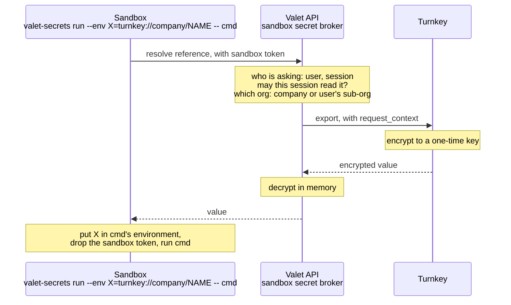
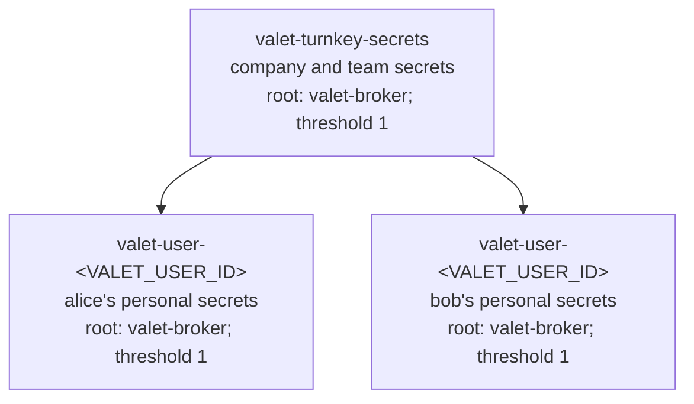

# Turnkey Secrets for Valet — Design

**Date:** 2026-10-29
**Status:** Draft for review

## Overview

Valet sandboxes need secrets, such as the credentials that run the mono local
stack. Today those come from 1Password. This design moves every Valet secret,
company, personal, and team, to Turnkey Secrets.

- **Where secrets live.** Company and team secrets live in one Turnkey
  organization, `valet-turnkey-secrets`. Each user's personal secrets live in
  that user's own sub-organization, created the first time they save one.
  Valet keeps no copy of any value.
- **Who holds the keys.** One Turnkey API key, the Valet broker key, held by
  the Valet API. It is the root user of every organization.
- **Who decides access.** Valet. The broker checks which session may read or
  change which secret before it calls Turnkey.
- **What Turnkey adds.** Encrypted storage, a hard boundary between users'
  secrets, and a record of every export naming the Valet user and session
  that asked.
- **If the broker key is stolen.** The thief can read and change every secret
  and keep access after the key is rotated. A later phase moves root to the
  human administrators so Turnkey policy also checks every export.
- **What this does not do.** It does not hide a secret from the process that
  receives it.

| Phase | Adds |
| --- | --- |
| v1 | Company secrets for the local stack, a provisioning command, 1Password removed |
| v1.1 | Personal secrets in user sub-organizations, secret entry in the Valet UI |
| v1.2 | Team secrets in the company organization |
| Later | Administrators as root, a non-root broker, and Turnkey policy on every export |

This spec covers the Turnkey side in detail and the Valet side at a high
level. The Valet implementation is a follow-up.

## Valet architecture



- **Sandbox.** Runs agent code and holds only its sandbox token, which is
  scoped to one session and expires. `valet-secrets run` works this way today
  for 1Password references. It switches to `turnkey://` references.
- **Valet API.** The sandbox secret broker authenticates the sandbox token,
  decides access, picks the organization, and is the only component that holds
  the broker key and talks to Turnkey.
- **Valet database.** Maps each Valet user to their sub-organization. It holds
  no secret values.

## Organizations



- **Company organization.** `valet-turnkey-secrets`, created once. The broker
  user, `valet-broker`, is its only root user.
- **User sub-organization (v1.1).** The broker creates it with
  `CREATE_SUB_ORGANIZATION_V9`, with itself as the only root, the first time
  the user saves a personal secret. Users who never save one never get one.
  Sub-organizations are created only through the API, with no limit on count.
- **One key everywhere.** The same P-256 key pair is the broker's API key in
  every organization.
- **No policies yet.** Root bypasses policy. Policy arrives in the later
  hardening phase.

The company organization can list a sub-organization's secrets but cannot
import, export, or delete them. The broker does those as root in the
sub-organization itself. Deleting a sub-organization also needs its root.

## Secrets

The scope is a prefix in the Turnkey name. The part after the last `/` is the
environment variable name: letters, digits, and underscore, not starting with
a digit.

| Scope | Phase | Organization | Turnkey name | Reference |
| --- | --- | --- | --- | --- |
| Company | v1 | company | `company/DATABASE_URL` | `turnkey://company/DATABASE_URL` |
| Personal | v1.1 | user's sub-organization | `personal/OPENAI_KEY` | `turnkey://personal/OPENAI_KEY` |
| Team | v1.2 | company | `team/<TEAM_ID>/DATABASE_URL` | `turnkey://team/<TEAM_ID>/DATABASE_URL` |

Static properties are bound to a secret permanently at import, so every secret
gets them from v1 even though no policy reads them until the hardening phase:

- `scope`: `company`, `personal`, or `team`.
- `valet_company_org_id`: the Valet organization ID.
- `valet_owner_user_id`: personal secrets only.
- `valet_owner_team_id`: team secrets only.
- `valet_created_by_user_id`: who imported the secret.

Turnkey facts that shape this:

- Names are unique within one organization.
- Secrets are immutable. Rotation is delete, then import, with a short gap
  where the name does not exist.
- `list_secrets` has no name filter and returns at most 100 per page, so
  finding a name means paging.
- Activities in sub-organizations bill to the parent. The first 100 secrets
  are free. Whether that count spans sub-organizations needs confirming with
  Turnkey.

## Export and audit

Each secret in an export carries a `request_context` of string pairs, taken
from the sandbox principal and never from the request body:

- `valet_company_org_id`, `valet_user_id`, and `valet_session_id`.
- `valet_session_owner_type` (`user` or `team`) and `valet_session_owner_id`.
- `valet_owner_team_id` for team secrets, after Valet checks the session can
  read that team.

Turnkey records the context with the activity, which is the audit trail. It
does not verify it. A claim compared with a static property uses the same name
as that property. A batch export is all-or-nothing, so one denied secret fails
the whole call.

## Access

| Scope | Who can read the value | Who can create, replace, delete |
| --- | --- | --- |
| Company | Any session in the Valet organization | Operators with the provisioning command; org admins in the Valet UI from v1.1 |
| Personal | User-owned sessions where the token holder is the owner | The owner |
| Team | Sessions owned by the team or by a member | Team members |

Any org member can list metadata from v1.1. No route returns a value except
the sandbox broker.

## Security

- The broker key can read, change, and delete every secret and add users and
  keys in every organization. It lives with the other deployment secrets and
  never in a sandbox.
- A stolen broker key can register a key of its own and keep access after
  rotation. v1 accepts this. The hardening phase removes it.
- A bug in Valet's access check can expose any secret to any session. Nothing
  in Turnkey catches it until the hardening phase.
- Plaintext exists only on the machine that encrypts it at import, in broker
  memory for one request at export, and in the receiving process's
  environment.

## Later: hardening

The broker is root while it is the only Turnkey user, which makes the move
self-service:

1. Each Valet org admin enrolls a Turnkey user with a passkey and an API key.
   These users form the Valet-Admin-Quorum, threshold 2 when there are at least
   two.
2. The broker, still root, adds those users, creates a `valet-broker` tag on
   itself, and installs the policies below.
3. The broker sets the root quorum to the Valet-Admin-Quorum only and becomes
   an ordinary user.

This runs in the company organization and in every user sub-organization.
Every later admin change then needs quorum approval once per organization.

Each policy has the consensus
`approvers.any(u, u.tags.contains('<VALET_BROKER_TAG_ID>'))`, so only the
broker can use it. One allows import and delete. One, in the company
organization only, allows `CREATE_SUB_ORGANIZATION_V9`. One per scope allows export
when the context matches the secret's static properties:

```json
{
  "policyName": "valet-broker: export personal secrets",
  "effect": "EFFECT_ALLOW",
  "consensus": "approvers.any(u, u.tags.contains('<VALET_BROKER_TAG_ID>'))",
  "condition": "activity.type == 'ACTIVITY_TYPE_EXPORT_SECRETS' && secret.static_properties['scope'] == 'personal' && request_context['valet_company_org_id'] == secret.static_properties['valet_company_org_id'] && request_context['valet_user_id'] == secret.static_properties['valet_owner_user_id'] && request_context['valet_session_owner_type'] == 'user' && request_context['valet_session_owner_id'] == secret.static_properties['valet_owner_user_id']"
}
```

The company policy compares `scope` and `valet_company_org_id`. The team
policy adds `valet_owner_team_id`. A missing context key makes the condition
error, and an erroring allow does not allow.

The broker still writes its own context, so a stolen broker key can send false
claims. Policy then limits the key to the secrets activities and catches a bug
in Valet's check. A user can always change its own credentials, so a stolen
key can still add a key to the broker user. That keeps only broker access, and
the quorum ends it by replacing the user.

## Follow-up

Valet-side detail, specified separately. How each piece should work:

- **Reference routing.** The broker sends `turnkey://` references to the
  Turnkey provider and rejects every other prefix. `.valet/credentials.yaml`
  accepts only `turnkey://`.
- **Provisioning command.** `pnpm valet turnkey import NAME` reads the value
  from stdin, encrypts it with `encryptSecretToBundle` on the operator's
  machine, and imports it as `company/NAME` with company static properties;
  `list` and `delete` never print values.
- **User-to-sub-organization table.** `turnkey_user_sub_orgs` holds one row
  per Valet user with its sub-organization ID, written on first creation, with
  creation serialized per user so a retry never makes a second one.
- **Personal secret entry.** The API starts the import in the target
  organization and returns the enclave key, the browser encrypts the value,
  and the API builds the name and static properties itself before it submits
  the import.
- **Broker key deployment configuration.** `VALET_TURNKEY_ORG_ID`,
  `VALET_TURNKEY_API_PUBLIC_KEY`, and `VALET_TURNKEY_API_PRIVATE_KEY`, stored
  like `VALET_ENCRYPTION_KEY` and listed in `docs/environment-variables.md`.
- **Tests.** End-to-end against a test organization: a company secret
  resolves, a personal secret resolves for its owner and not for another
  user's session, and the export activity records the context.

## References

- `docs/specs/2026-09-01-sandbox-secret-broker-design.md`
- Turnkey: [Managed Secrets](https://docs.turnkey.com/features/secrets),
  [sub-organizations](https://docs.turnkey.com/features/sub-organizations),
  [root quorum](https://docs.turnkey.com/features/users/root-quorum),
  [policy language](https://docs.turnkey.com/features/policies/language)
