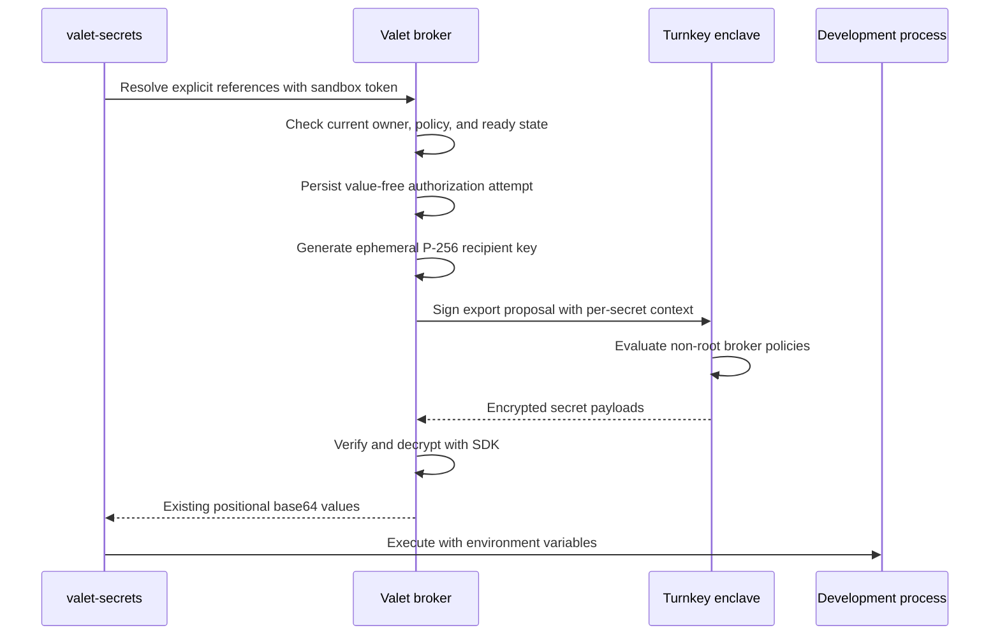

# Turnkey Secrets integration for Valet

**Date:** 2026-10-29
**Status:** Draft for review
**Owners:** Conner Swann and Xiangan He
**Reviewers:** Carey Janecka and Zeke Mostov

## 1. Mental model and design summary

Each person gets a locked cabinet in Turnkey.
That cabinet is a Turnkey sub-organization, called a sub-org below.
Valet keeps a separate key for that cabinet outside the person's sandbox.
The person puts a development credential into the cabinet from their browser.
A sandbox command asks Valet to deliver that credential into one process's environment.

A **session** is Valet's unit of sandbox ownership.
Threads within a session can share its sandbox and token.
Valet checks the session's owner and permissions before it asks Turnkey to export the credential.
A **broker user** is a non-root Turnkey user that Valet uses for one sub-org's secret operations.
Turnkey checks that user's policies before it releases encrypted data.

The receiving development process has the plaintext secret.
That process can print, copy, or transmit it.
This design keeps secrets out of normal model replies and credential storage.
It does not prevent agent-authored code from stealing a materialized secret.

The first use case is per-user development credentials for the mono local stack and tests.
Carey's Granola workflow setup is a second example of the per-user need.
Conner and Xiangan own delivery.
This draft uses the [Turnkey Managed Secrets documentation](https://docs.turnkey.com/features/secrets.md).
It also uses the linked policy, sub-organization, and programmable credential access documents in section 2.

### Who can do what

- **Alice:** Alice imports, lists, and deletes her personal secrets in Valet. She controls personal secret permissions within organization limits. Her allowed sandbox commands receive plaintext.
- **Valet org admin:** The admin connects the dedicated Valet parent key and sets organization secret policies. The admin can deny materialization. The admin cannot edit the deployed human-root list through Valet.
- **Team admin:** In phase 2, a team admin manages that team's secrets and policies. Team administration does not grant Turnkey root membership.
- **Valet server:** The server creates user sub-orgs automatically. A temporary setup key installs a non-root broker and removes itself. The server then uses the broker key for approved secret operations.
- **Turnkey root admins:** Human admins hold root credentials outside Valet. Their quorum can change policies, replace broker keys, and export any secret in that sub-org.

### Design summary

An org admin pastes one non-root parent API key into Valet's Turnkey connection form.
The form also needs the parent organization ID and API public key.
Deployment operators pin the human root public keys outside the Valet database.
Valet lazily creates a user sub-org with those humans and a one-time setup key as roots.
The setup key installs the broker and its policies.
It then makes the humans the only roots and deletes its own API key.
Valet verifies that result before it allows any secret import or export.
An independent audit checks the root configuration outside Valet.

V1 supports browser-encrypted import, live metadata listing, delete, and explicit `valet-secrets run` references.
Materialization defaults to per-name allowlists.
Existing `op://` commands remain supported.
The two-week pilot serves personal development credentials only.
Shared scopes retain separate team-admin and org-admin management in the phase-2 design.

### Explicit v1 non-goals

| Excluded from the first release | Reason | Later integration point |
| --- | --- | --- |
| Team and organization secret delivery | Personal credentials unblock the first use case | The owner mappings in section 3 |
| Turnkey discovery from a sandbox | Sandbox metadata enumeration increases exposure | A separately reviewed phase-2 discovery command |
| A rotate endpoint and metadata index | Delete, import, and live listing cover the pilot | Phase-2 management improvements |
| Automatic policy-drift alerts | Independent root audit covers the bootstrap risk | Phase-2 policy monitoring |
| Pending interactive approvals during shell resolution | The current CLI has a 30-second request timeout | A durable approval flow with a new CLI contract |
| Plaintext read buttons or secret-returning agent actions | They would put plaintext into tool results or API responses | A separately reviewed product requirement |
| `tk` CLI installation, short-lived Turnkey grants, and commit signing | They are follow-on work | The same per-owner Turnkey identity |
| Moving OAuth refresh tokens or integration app keys into Turnkey | Those consumers have separate renewal and signing rules | Explicit credential references after a separate review |
| Automatic 1Password copying or fuzzy provider fallback | Migration requires an explicit source choice | Per-reference migration |
| Production credentials and strong non-disclosure from sandbox users | Arbitrary development code receives plaintext | A separate restricted execution service |

### Acceptance scenario

Start with Alice and Bob and a dedicated Valet parent connection.
Deployment config contains the approved human root public keys.
Use only synthetic development credentials.

1. Alice opens Personal workspace Secrets.
2. Valet automatically creates and activates Alice's sub-org through the self-removing setup key.
3. Valet verifies that only the pinned humans remain root.
4. Alice imports `granola/api-key` through browser-side encryption.
5. Alice allows that exact name in her personal materialize policy.
6. Alice runs a development test with `tksecret://personal/granola/api-key`.
7. The child process receives the exact test value.
8. Bob cannot list or resolve Alice's secret.
9. An organization deny blocks Alice's next resolution despite her personal allow.
10. An existing `op://` command still succeeds.

All steps must pass in one run from a clean database.
Sections 5, 6, and 13 define the failure cases.
The implementation adds tests for these cases.
This docs-only change adds no test infrastructure.

## 2. Verified foundations

These are observations from the documentation and SDK fetched on 2026-10-29.
They are separate from the proposed Valet behavior below.

| Fact | Evidence and consequence |
| --- | --- |
| Names are unique within a Turnkey organization | [Managed Secrets](https://docs.turnkey.com/features/secrets.md) and SDK `ImportSecretParams` document uniqueness |
| Static properties are permanent | The public API's `ImportSecretParams` permanently binds them at import |
| The API provides import, export, list, and delete | The fetched public API has no update-secret operation. Values are immutable. |
| Same-name replacement requires delete, then import | Valet must expose the interruption and possible replacement failure |
| Root quorum bypasses policy | [Root quorum](https://docs.turnkey.com/features/users/root-quorum.md) and [policy evaluation](https://docs.turnkey.com/features/policies/overview.md) evaluate root first |
| A parent has read-only child visibility | [Sub-organizations](https://docs.turnkey.com/features/sub-organizations.md) documents parent visibility. Parent listing grants no child secret-operation permission. |
| Export targets an ephemeral P-256 recipient key | Managed Secrets uses the established enclave secure channel and HPKE |
| Batch export is all-or-nothing | One denied secret rejects the entire Turnkey export activity |
| Context is per secret, signed, and audited | Managed Secrets describes `request_context` as asserted claims. Turnkey does not verify those claims. |
| Policies can read context | The [Secrets language section](https://docs.turnkey.com/features/policies/language.md#secrets) supports `request_context['key']` |
| Missing context keys cause evaluation errors | An erroring allow policy does not allow. An erroring deny policy does not deny. |
| Duplicate context keys are rejected | Turnkey rejects duplicates within one secret before policy evaluation |
| Listing has no name or prefix filter | [List secrets](https://docs.turnkey.com/api-reference/queries/list-secrets.md) accepts organization ID and pagination only |
| The first 100 secrets are free | Managed Secrets asks customers to contact sales beyond that count. Sub-org activities roll up to the parent for billing. |

With threshold 1, each human root alone can export any secret.
A satisfied root quorum bypasses all policies.
The final human-root threshold should be at least 2 when there are at least two admins.
A deployment with only one human admin uses threshold 1.
The online broker is a non-root user in every Turnkey organization.

### SDK evidence

The inspected `tkhq/sdk` revision is `9181fbc80f7011a4264eb7a1e02db9eb92a85c97`.
The published releases `@turnkey/sdk-server@8.8.0` and `@turnkey/crypto@2.13.3` contain the required helpers.
The npm tarballs were checked for this revision.
V1 pins these releases.
The source links below retain the original inspected revision for reference.

- [`packages/sdk-server/src/secrets.ts`](https://github.com/tkhq/sdk/blob/9181fbc80f7011a4264eb7a1e02db9eb92a85c97/packages/sdk-server/src/secrets.ts) defines `ExportSecretItem.requestContext` and `CreateExportSecretsProposalParams.secrets`.
- [`packages/sdk-server/src/sdk-client.ts`](https://github.com/tkhq/sdk/blob/9181fbc80f7011a4264eb7a1e02db9eb92a85c97/packages/sdk-server/src/sdk-client.ts) implements `importSecret`, `exportSecret`, `getSecrets`, `createExportSecretsProposal`, `submitExportSecrets`, and `awaitExportedSecrets`.
- `createExportSecretsProposal` supports batches with per-secret `requestContext` today.
- It sorts context keys and converts the record to the existing API key-value array.
- `getSecrets` forwards pagination to `listSecrets`.
- It does not fetch every page automatically.
- `init_import_secrets` is now in the [public API](https://docs.turnkey.com/public_api.swagger.json).
- The 8.8.0 server helper still uses `command` for this call.
- A missing generated wrapper does not require a Turnkey API change.
- [`packages/crypto/src/turnkey.ts`](https://github.com/tkhq/sdk/blob/9181fbc80f7011a4264eb7a1e02db9eb92a85c97/packages/crypto/src/turnkey.ts) provides `encryptSecretToBundle` and `decryptSecretBundle`.

Transfers use Turnkey's [enclave secure-channel protocol](https://docs.turnkey.com/security/enclave-secure-channels.md).
The SDK defines the ciphertext and signing formats.
The [programmable credential access guide](https://docs.turnkey.com/solutions/key-management/programmable-credential-access.md) documents proposal signing and consensus.
V1 uses unilateral broker export after Valet authorization.
V1 does not equate a Valet approval with a Turnkey co-signature.

## 3. Organization topology and bootstrap

### Placement

| Valet scope | Turnkey placement | Final root administrators | Online credential |
| --- | --- | --- | --- |
| Valet deployment | Dedicated Valet parent org | Human deployment administrators | Non-root provisioner key |
| User | One direct child per immutable Valet user ID | Pinned human admins | Distinct non-root broker key |
| Team, phase 2 | One direct child per immutable Valet team ID | Pinned human admins | Distinct non-root team broker key |
| Organization secrets, phase 2 | One dedicated shared-secrets child | Pinned human admins | Distinct non-root organization-secrets broker key |

The parent is dedicated to Valet.
It is separate from the company's existing Turnkey org.
Every parent-org user has implicit metadata read access to all children.
A dedicated parent keeps unrelated company users outside that metadata domain.
The parent holds no development secrets.

Team sub-orgs are siblings of user sub-orgs.
A dedicated child holds organization secrets.
These boundaries keep each broker's secret-operation permissions inside one owner scope.
They also separate the parent provisioner from shared-secret operations.
A broad team policy cannot authorize export from a sibling's sub-org.

Team admins manage secrets through Valet in phase 2.
They do not become Turnkey roots automatically.
Personal sub-orgs are company-managed storage for each user's Valet credentials.
Human root quorum can export any stored value.
Personal secrets are therefore not private from those human root admins.

The parent key creates children and reads metadata.
Its parent status grants no child import, export, or delete permission.
Each broker key authenticates as a user inside one child.
Valet generates a distinct broker key pair for each child.
The one-time setup key is also distinct for each child.

### Admin connection and pinned human roots

An org admin opens Organization Apps and plugins, then Turnkey Secrets.
The admin supplies the dedicated parent org ID, API public key, and API private key.
The pasted key must belong to a non-root provisioner user.
Valet checks its user and root membership before storing the private key.
If the user is root, Valet rejects the connection and stores no private key.
The error says: `This key belongs to a root user. Rotate it and connect a non-root provisioner key.`
The UI clears the private-key input after submission.
Request bodies and credentials never enter logs or error reports.

Human admins install this parent allow policy for the provisioner:

```json
{
  "policyName": "Valet sub-org provisioning",
  "notes": "Provisioner is non-root in a dedicated Valet parent org.",
  "effect": "EFFECT_ALLOW",
  "consensus": "approvers.any(u, u.id == 'provisioner-user-example')",
  "condition": "activity.kind == 'CREATE_SUB_ORGANIZATION'"
}
```

The provisioner also has the credential-mutation deny in section 5.
It has no secret-operation or policy-management allow.
The version-agnostic kind replaces a version-specific activity type.
Carey must confirm that this kind includes V9.

Deployment operators pin human root API public keys in deployment config or deployment-managed secrets.
The config also pins the final quorum threshold.
Valet org-admin routes cannot change that config.
The database records only the config fingerprint used for a child.
It is not the source of the root list.
Human root private keys remain on administrator-controlled systems outside Valet.
V1 registers API-key roots through `RootUserParamsV6.apiKeys`.
Passkey registration requires its own challenge and attestation flow.
V1 does not copy passkey records between sub-orgs.

### Automatic lazy provisioning

A **provisioning intent** is a saved record of one requested sub-org creation.
It binds the Valet owner, pinned root-config fingerprint, and exact creation request.
The first authorized visit to personal Secrets starts provisioning for that user.

1. Valet serializes creation on `(org_id, owner_type, owner_id)`.
2. Valet saves the provisioning intent before submitting an activity.
3. Valet generates one-time setup and broker key pairs outside sandboxes.
4. The provisioner creates the child with the pinned humans and setup key as roots.
5. The initial root quorum threshold is 1.
6. The setup key creates the non-root broker user inside the child.
7. The setup key installs the import, export, delete, and credential-mutation policies.
8. The setup key submits `UPDATE_ROOT_QUORUM` with only the pinned humans as roots.
9. The update sets the final pinned human quorum threshold.
10. The setup key deletes its own API key.
11. Valet verifies the root quorum, users, API keys, and policies through the broker's metadata reads.
12. Valet removes its stored setup private key and marks the scope `ready`.

`CreateSubOrganizationIntentV9` accepts API-key roots through `RootUserParamsV6.apiKeys` in the public API.
The setup key uses root permission only while the child is empty.
Valet permits no secret import or export before setup completes.
After quorum update, the setup user is non-root.
The design relies on Turnkey's implicit self-credential permission for its own-key deletion.
The live setup test must confirm that this permission works after root removal.
The broker and provisioner credential denies do not apply to the separate setup user.
After deletion, the setup user has no credential or policy allow.
Valet verifies that it has no unexpected credential.

The temporary setup private key is encrypted at rest only for provisioning recovery.
It never enters a sandbox, transcript, or ordinary credential read.
Valet records each completed setup step before advancing.
A restart resumes from the recorded child and checks its actual state.
Before signing any creation request, Valet compares its root parameters with deployment config.
The comparison also applies to recovered creation requests.
A config mismatch stops recovery for human review.
An ambiguous create response is recovered through the saved activity before any new create attempt.
The scope remains unavailable if removal or verification fails.
A `needs_operator` state names the failed step for human root recovery.
If root removal has completed, Valet never restores the setup user to root.

A daily audit runs outside the Valet API under a separately held read-only parent credential.
That user has a policy denying mutation activities.
The auditor enumerates all children, including children absent from Valet's database.
It compares each root quorum against the independently pinned human-root config.
It checks that setup keys are gone and brokers are non-root.
It also checks broker users for unexpected credentials.
The auditor sends mismatches to the deployment operators' alert channel.
This audit is part of v1.
It does not depend on Valet's own ready-state assertion.

The proposed self-removal order needs Carey's confirmation in section 12.
Manual human activation is the fallback only if Carey confirms that this order cannot work.
It is not the default user flow.
V1 requires no operator setup tool.

In phase 2, team sub-org creation is also lazy.
The first authorized team-secret setup triggers it.
Creating a Valet team records no synchronous Turnkey dependency.
A Turnkey outage must not prevent team creation.

## 4. Plugin, settings, and secret model

### Existing integration seams

`CredentialDeclaration` in `packages/engine/src/valet-plugin.ts` describes manual key entry.
`credentialsRouter` in `packages/api/src/routes/credentials.ts` handles user, team, and organization credential owners.
`PgCredentialStore` in `packages/api/src/plugins/credential-store.ts` encrypts secret columns with the instance key.
Its metadata column is ordinary JSON.
Private keys must never be stored in metadata.

The integration manifest follows the **Adding a plugin (v2)** section of `CLAUDE.md`.
That section defines the package layout and manifest registration.
Secret permission entries use the permission-only catalog proposed below.
They are not executable plugin actions.
The admin connection uses a dedicated settings form because Turnkey needs three connection fields.
The form follows the existing settings grouping in `docs/specs/2026-10-08-settings-redesign-design.md`.
Personal workspace Secrets shows provisioning status and personal secret metadata.
The later team page pins its team ID from the settings route.

Reserve `turnkey:provisioner`, `turnkey:broker:<scope-id>`, and `turnkey:setup:<scope-id>` as internal credential services.
Store each private key in `apiKeyEnc` through the existing encryption helpers.
Store public key, Turnkey organization ID, and broker user ID as metadata.
Extend `isDeniedCredentialService` in `packages/api/src/services/credential-resolution.ts` with exact `turnkey:provisioner` matching.
It also rejects every service with the `turnkey:broker:` or `turnkey:setup:` prefix.
An exact match on a literal placeholder would leave real scope keys readable.
Refuse generic credential PUT, delegation, and reference writes for these reserved services.
The plugin must not declare its broker key as an ordinary org-provided action credential.
The service adapter selects internal credentials only after checking the caller and permission.

### References and names

Use a provider-specific locator alongside the existing `op://` locator.
The locator selects a secret through Valet.
Turnkey requests use the existing SDK wire format.

```text
tksecret://personal/granola/api-key
tksecret://team/mono/local-stack/database-password
tksecret://org/mono/package-registry-token
```

The URI scope label is `personal`, `team`, or `org`.
V1 accepts only `personal` for Turnkey references.
The remaining path is the exact Turnkey secret name.
For v1, names contain lowercase ASCII letters, digits, `/`, `.`, `_`, and `-`.
Each path segment must be nonempty.
Reject `.` and `..` segments, percent escapes, control characters, queries, fragments, userinfo, and ports.
Names contain no secret material or personal contact information.
The `personal` scope label selects the session owner's sub-org.
The phase-2 `team` scope label selects the session's persisted team owner.
Callers cannot choose a different user or team in the locator.

```sh
valet-secrets run --env GRANOLA_API_KEY=tksecret://personal/granola/api-key -- granola-test
```

```yaml
commands:
  - command: granola-test
    env: GRANOLA_API_KEY
    reference: tksecret://personal/granola/api-key
```

`loadCredentialCommands` in `packages/api/src/engine/credential-commands.ts` currently accepts only an `op://` prefix.
Extend it with the same strict provider parser used by the broker.
`secretsCliScript` and `commandWrapperScript` in `packages/api/src/engine/secrets-cli-script.ts` retain environment delivery.
An explicit Turnkey reference never falls back to 1Password.
A supplied `--scope` must agree with the Turnkey scope label.
The public CLI label `personal` maps to the database owner type `user`.

V1 keeps `valet-secrets find` on 1Password only.
The sandbox cannot search or list Turnkey metadata.
The browser Secrets page supplies exact references for the user to copy into commands or repository declarations.
Repository declarations do not grant access.

The phase-1 CLI work includes help text, error text, and `find` flag parsing.
`run` help describes both supported URI schemes.
Resolution errors name the selected provider and its corrective action.
`find` help explicitly says that it searches 1Password only.
Its existing `--scope` parser and wrapper candidate parsing continue to accept the current syntax.
Unsupported flags fail with usage guidance.
V1 adds no `--provider` flag.
Tests cover these branches so a new Turnkey reference cannot enter 1Password discovery accidentally.

### Static properties

Valet constructs these string properties on every import:

```json
{
  "valet_schema": "1",
  "valet_org_id": "org-example",
  "valet_scope": "user",
  "valet_owner_id": "alice-example",
  "purpose": "development",
  "materialization": "sandbox-env"
}
```

The server derives organization, scope, and owner from authenticated state.
The client cannot override reserved properties.
V1 fixes purpose to `development`.
A later team import uses `valet_scope: team` and that team's immutable ID.
These properties classify secrets for export policy.
They do not prove the identity of the receiving process.
Changing a property requires secret replacement.

Each secret contains one credential value.
Packing unrelated credentials into a JSON secret would make export disclose unrelated values.
For 80 users with eight credentials each, personal storage alone needs 640 secrets.
Sub-org activities roll up to the dedicated parent for billing.
The free allowance's scope remains an open question for Carey.

## 5. Authorization in two layers

### Layer one: Valet identity and permission

The existing broker requires `c.var.sandbox` in `packages/api/src/routes/sandbox-secrets.ts`.
`sessionOwnerRow` reads the persisted session owner or `workflowSessionOwner`.
`onePasswordScopesFor` in `packages/api/src/services/credential-resolution.ts` defines current provider scope access.
The existing routes do not invoke the action-policy resolver.
Turnkey authorization is new work at this route.
Current 1Password resolution uses its existing owner checks without the new Turnkey policy adapter.

Before any Turnkey metadata query or export, the broker must:

1. Authenticate the sandbox through `verifySandboxToken` in `packages/api/src/auth/sandbox-tokens.ts`.
2. Load the current session owner from durable state.
3. Check current organization membership and account state.
4. Refuse Turnkey references from team sessions in v1.
5. Select the exact allowed secret scope.
6. Check the scope's ready state and secret policy.
7. Write a value-free authorization attempt before contacting Turnkey.

Personal export requires a user-owned session whose owner matches the sandbox principal's user ID.
A team session's stored actor is the person who first created it.
That identity does not make the session personal.
A team-owned session never borrows that person's personal sub-org.
An unknown owner gets no Turnkey scope.
This is stricter than the existing broker's organization fallback.
A moved session loses its old personal scope immediately.
A deleted or disabled scope cannot export through an old token.

`ensureAssistantExecution` in `packages/api/src/assistants/service.ts` allocates team conversation sessions.
`canAccessSessionResources` in `packages/api/src/services/session-access.ts` checks session resource access.
`threadReadAccess` in `packages/api/src/services/thread-access.ts` checks the thread audience.
The implementation must use persisted session ownership.

A sandbox token identifies a session.
It contains no thread or active-submission identity.
The broker cannot verify a caller-supplied thread ID as a stronger security principal.
V1 permissions therefore apply to the entire session's secret scope.
V1 ignores thread approval bypass and action runtime grants for secret resolution.
The audit records the session ID.
It leaves the thread ID empty unless the host supplies verified provenance.
Any process with the same token can request the same allowed development secrets.
The normal personal session is shared across its threads.
The token does not expire during that session's lifetime.
A compromised sandbox or prompt injection can export every name allowed for that session owner.
Repeated calls bypass the 25-reference batch limit as an inventory boundary.
V1 therefore defaults materialization to explicit per-name allowlists.

`docs/specs/2026-10-13-thread-sharing-design.md` keeps guest turns out of the owner's sandbox tools.
A shared-thread reply grants no direct secret endpoint access.
Owner-run code still shares the session's sandbox boundary.
Per-thread secret restrictions need a later host-authenticated invocation capability.
Tool focus alone cannot enforce them against an allowed shell.

### Permission operations and Settings catalog

These IDs identify permissions under service `turnkey_secrets`.
They do not identify model-callable tools.

| Permission ID | Default | Who can use it |
| --- | --- | --- |
| `turnkey_secrets.list` | Allow | Personal owner through browser Settings only |
| `turnkey_secrets.import` | Require approval | Personal owner through browser Settings |
| `turnkey_secrets.materialize` | Require approval | Authorized personal session with an explicit name allow |
| `turnkey_secrets.delete` | Require approval | Personal owner through browser Settings |

The server supplies `scope`, `ownerId`, `name`, and `purpose` to the permission check.
Ciphertext and plaintext are absent from policy parameters.
Each materialize allow uses `name` with `eq` or `in` matchers naming exact secrets.
An empty matcher list, wildcard, or name regex cannot grant Turnkey materialization in v1.
The broker checks each requested name separately.
The policy editor rejects broad materialize allows for this service.
An org-wide allow cannot silently enable whole-scope export.

A user's personal override applies to `turnkey_secrets.*` on their own personal scope.
Alice can change her personal name allowlist within organization bounds.
Her settings do not authorize another user's scope or a shared scope.
An organization deny always wins over a personal override.

The existing tables are `actionPolicies` and `actionPolicyOverrides` in `packages/api/src/schema/index.ts`.
`loadPolicyRows` in `packages/api/src/policies/service.ts` loads current settings.
`resolvePolicyDecision` in `packages/api/src/policies/resolution.ts` implements the existing policy precedence.
The generic resolver selects rules by specificity.
V1 adds a service-specific check before that resolver: any matching organization deny rejects the secret operation.
The check uses `evaluateMatchers` in `packages/api/src/policies/matchers.ts` against the server-derived parameters.
It also checks expiry and whether the policy applies to this request.
This rule applies even when a more-specific personal or organization allow exists.
Settings previews and override bounds use the same secret-policy check.
Other integrations keep their existing precedence.

The broker adapter supplies empty runtime-grant and workflow-grant lists.
It ignores thread approval bypass.
It applies personal overrides only when the operation's scope is that user's personal scope.
The connection's disabled state stops all Turnkey operations.

Settings currently derives permissions from executable action catalogs.
`findCatalogAction` and `listToolPermissions` in `packages/api/src/policies/admin.ts` read plugin actions.
The preview route in `packages/api/src/routes/policies.ts` uses `findAction` from `packages/api/src/plugins/action-invoker.ts`.
Registering fake executable actions there would make secret permissions callable by models.

V1 adds a small permission-only descriptor list to the API policy catalog.
Each descriptor contains ID, name, description, risk, default mode, and parameter schema.
It contains no `execute` function.
`PolicyCatalog`, `findCatalogAction`, and `listToolPermissions` accept this list alongside existing action metadata.
The org-policy preview route checks it before calling `findAction` for ordinary actions.
`meToolPermissionsRouter` in `packages/api/src/routes/me-policies.ts` merges it into Settings responses.
Override validation recognizes the same IDs and name constraints.
The engine tool registry and action invoker never register these descriptors.
A direct `call_tool` request for `turnkey_secrets.materialize` remains unknown.
Only the browser management routes and sandbox resolve route execute the underlying operations.

V1 proceeds only when the fresh decision is `allow`.
A `deny` returns 403 before any Turnkey secret operation.
A `require_approval` returns 403 with instructions to configure an exact-name allow in Settings.
Shell requests do not open pending decision gates.
Unattended workflows fail the step and report the missing permission.
Management UI operations also require explicit confirmation.
The confirmation does not replace the standing policy check.

### Set-without-read boundary

Import and materialize are separate Valet permissions.
Import validation never exports the saved value.
Delete permission is also separate.
An import-only actor cannot replace an existing name without delete permission.

This separation limits Valet's UI and API operations.
It does not provide non-disclosure from code running in a materialization-enabled sandbox.
In phase 2, anyone who can drive an allowed shared session can use `printenv` to read a delivered secret.
Denying that person's UI read does not change what their sandbox command can do.
The shared-scope set-without-read acceptance test belongs to phase 2.
A stolen broker key also bypasses this Valet permission distinction.

### Layer two: Turnkey policy on the non-root broker

The setup key installs one template per child with literal broker and owner IDs.
The following JSON uses illustrative IDs.
The setup process replaces them with the child-local IDs.

```json
{
  "policyName": "Valet personal development export v1",
  "notes": "Installed during setup. Broker is non-root.",
  "effect": "EFFECT_ALLOW",
  "consensus": "approvers.any(u, u.id == 'broker-user-example')",
  "condition": "activity.type == 'ACTIVITY_TYPE_EXPORT_SECRETS' && secret.static_properties['valet_schema'] == '1' && secret.static_properties['valet_org_id'] == 'org-example' && secret.static_properties['valet_scope'] == 'user' && secret.static_properties['valet_owner_id'] == 'alice-example' && secret.static_properties['purpose'] == 'development' && secret.static_properties['materialization'] == 'sandbox-env' && request_context['valet_org_id'] == secret.static_properties['valet_org_id'] && request_context['valet_owner_id'] == secret.static_properties['valet_owner_id'] && request_context['operation'] == 'materialize' && request_context['recipient'] == 'sandbox-env'"
}
```

The same child broker can submit encrypted imports after Valet authorizes the actor:

```json
{
  "policyName": "Valet encrypted import v1",
  "notes": "Valet authorizes actor and supplies reserved import properties.",
  "effect": "EFFECT_ALLOW",
  "consensus": "approvers.any(u, u.id == 'broker-user-example')",
  "condition": "activity.type == 'ACTIVITY_TYPE_INIT_IMPORT_SECRETS' || activity.type == 'ACTIVITY_TYPE_IMPORT_SECRETS'"
}
```

Deletion uses a separate allow:

```json
{
  "policyName": "Valet deletion v1",
  "notes": "Valet checks owner and delete permission before submission.",
  "effect": "EFFECT_ALLOW",
  "consensus": "approvers.any(u, u.id == 'broker-user-example')",
  "condition": "activity.type == 'ACTIVITY_TYPE_DELETE_SECRETS'"
}
```

The shown `secret` fields apply to export evaluation.
The import and delete policies make no per-secret-property restriction.
These import and delete allows cover the whole child org.
The separate child boundary limits their reach to one owner.
No policy allows the broker to change policies or root quorum.
No policy allows it to change organization authentication or recovery settings.
Human administrators review other inherited or preexisting allows before activation.
An unrelated broad export allow would bypass this template's conditions.

V1 also installs a credential-mutation deny for the broker:

```json
{
  "policyName": "Valet broker cannot mutate credentials",
  "notes": "Human root quorum rotates broker keys and deletes broker users.",
  "effect": "EFFECT_DENY",
  "consensus": "approvers.any(u, u.id == 'broker-user-example')",
  "condition": "activity.resource == 'CREDENTIAL'"
}
```

The parent provisioner gets the same deny with `provisioner-user-example` as its consensus user.
These users cannot add, update, or delete their own credentials.
Rotating the broker key therefore requires human root quorum.
Provisioner key rotation also requires its parent human root quorum.
The separate temporary setup user retains its own-key deletion permission until removal.

Turnkey users retain implicit metadata read access inside their organization.
A missing list allow does not hide secret names from a stolen broker key.
The primary protections are the per-user sub-org boundary and the broker's non-root identity.
The export template checks classification consistency.
It does not stop a stolen broker key.
That broker can write properties through import and assert every context claim itself.

For every secret, Valet constructs the following context from trusted server state:

```json
{
  "valet_org_id": "org-example",
  "valet_owner_id": "alice-example",
  "operation": "materialize",
  "recipient": "sandbox-env",
  "session_id": "session-example",
  "request_id": "request-example"
}
```

The policy checks owner and purpose claims through positive allow conditions.
Missing required keys cannot satisfy that allow.
Session and request IDs support audit correlation.
Turnkey does not verify that either ID exists in Valet.
No client-supplied context passes through to the signed activity.

A stolen child broker key can assert these same context values.
It can export all matching development secrets to an attacker-chosen P-256 key.
It can import secrets and delete any secret in that child under the shown policies.
It can list that child's metadata.
It cannot use parent status to export a sibling child's secrets.
It cannot satisfy human root quorum or rewrite policies under these allows.
The credential-mutation deny blocks self-key persistence.
Offboarding removes the broker user and checks for unexpected credentials.
A stolen parent provisioner key can create unwanted child organizations and cause cost.
Its parent status alone cannot export existing child secrets.
A compromised Valet API process can obtain every online child broker key.
Per-user keys do not protect against that full server compromise.

## 6. Flows

### Browser import

1. The browser authenticates the person through the existing Valet session.
2. Valet checks the personal owner and the import policy.
3. Valet creates a short-lived import intent for one name and owner.
4. The child broker signs Turnkey's `init_import_secrets` request.
5. Valet returns the enclave ingress bundle and trusted organization ID.
6. The browser verifies the enclave signature through `encryptSecretToBundle`.
7. The browser encrypts the plaintext with Turnkey's SDK crypto.
8. The browser submits only `secretPayload`, `targetPublicKey`, and the intent ID to Valet.
9. Valet rechecks the personal owner and policy before submitting `importSecrets`.
10. Valet attaches the reserved name and static properties from the intent.
11. Valet records the completed secret ID and returns metadata only.

The browser clears the input after completion or cancellation.
Valet never calls the server `importSecret({ plaintext })` helper for this flow.
These endpoints disable request-body tracing.
They reject unexpected plaintext fields.
Payloads stay out of analytics, error reports, and audit JSON.
V1 accepts nonempty UTF-8 development credentials without NUL bytes.
Enforce the published Turnkey size limit once Carey confirms it.
Environment variables cannot represent NUL bytes.

The import intent binds one name, owner, and ciphertext attempt.
It expires after five minutes.
A completed intent returns the recorded secret ID on an identical retry.
A different payload for the same intent returns 409.
Persist the activity request before submission.
On an ambiguous provider response, recover the recorded activity before any new import.
Each new import attempt obtains a fresh ingress bundle.
Ingress keys are never reused across attempts.

Browser-side encryption protects against honest-server plaintext handling.
The Valet server still supplies the JavaScript application.
A compromised server or browser extension can steal the input before encryption.
This is not protection from a malicious application origin.

### Operator import

An administrator can use the official Turnkey SDK from their workstation.
The SDK `importSecret` helper encrypts locally before it submits the import.
The workstation uses a child-local import-authorized credential.
The parent credential alone is insufficient.
The workstation reads plaintext from a protected input source.
Plaintext stays out of command-line arguments.
The operation runs outside agent sandboxes.
The operator supplies the same reserved static properties.
An explicit metadata refresh discovers the completed secret.
Normal export policy rejects a secret with missing or different reserved properties.

### Materialization through the existing broker



The API is the export recipient in v1.
It briefly holds plaintext in process memory.
This retains the current shell CLI and broker response contract.
Base64 encodes the value.
It provides no encryption.
TLS protects the API-to-sandbox transfer.
V1 encrypts the export from Turnkey to the Valet API.
The API-to-sandbox hop is a separate TLS transfer.
A later native recipient helper could keep decryption inside the sandbox.

The published SDK supports same-child batch export through `createExportSecretsProposal`, `submitExportSecrets`, and `awaitExportedSecrets`.
The API returns a `secretPayloads` array without binding each decrypted value to a secret ID.
Carey must confirm whether payload order preserves request order.
Until that contract is confirmed, v1 uses one export activity per secret.
This avoids assigning a valid plaintext value to the wrong environment variable.
Each export activity uses a fresh recipient key pair.
The private key stays in request memory.
Retry and approval recovery never persist that key.
The adapter drops decrypted values and recipient keys after response completion.
JavaScript garbage collection does not guarantee immediate memory erasure.
No plaintext cache is permitted for the Turnkey adapter.

`MAX_REFERENCES` in `packages/api/src/routes/sandbox-secrets.ts` currently limits a request to 25 references.
Keep that limit.
Check every Turnkey reference before submitting any export in the request.
Group authorized references by child organization.
Turnkey provides atomicity within each export activity.
Valet cannot provide atomicity across organizations or providers.
If any group fails, return no Turnkey values and do not start the child process.
Earlier groups may already have exported into broker memory.
The audit records any completed provider exports before a later failure.
A failed Turnkey resolution returns no partial values.

Keep `ResolveSandboxSecretsResponse` in `packages/api/src/wire/types.ts` for successful responses.
`secretsCliScript` already decodes positional base64 values before execution.
It unsets `VALET_SANDBOX_TOKEN` from the child environment.
The credential mount may still contain that token.
The child also has access to its injected value and same-sandbox processes.
This remains one sandbox trust boundary.

A provider timeout ends resolution without starting the command.
An `ACTIVITY_STATUS_CONSENSUS_NEEDED` response fails with a setup-policy error.
The single-secret convenience helper reports `EXPORT_SECRET_CONSENSUS_NEEDED` for that case.
V1 does not preserve a recipient private key across a human approval wait.
The CLI's total request deadline remains 30 seconds.
The adapter must use a shorter provider deadline within that budget.
An API restart fails the in-flight request.
A new request creates a new recipient key and audit attempt.

### Live list and delete

The browser lists metadata through the selected child broker credential.
The parent credential is unnecessary for normal secret listing.
V1 reads live metadata without a local secret index.
`listSecrets` and `getSecrets` expose pagination without a name filter.
The adapter searches pages for an exact name during resolution.
A bounded scan returns an incomplete-list error if it cannot establish an exact result.
It does not report an exhaustive miss.
Before export, Valet checks the selected secret's reserved properties against the session owner.

The sandbox receives no Turnkey list or find endpoint in v1.
Existing sandbox `find` calls remain 1Password-only.
Names and static properties remain sensitive metadata.
The browser list route checks the current personal owner on every page.

Deletion requires owner permission, delete policy allow, and explicit confirmation.
Valet reports success only after Turnkey confirms deletion.
A timeout returns an unknown-outcome error with instructions to refresh the live list.
V1 adds no durable delete retry state machine.
A deleted value cannot be recovered from a Valet cache.

V1 replacement uses separate delete and browser import operations.
The old name is unavailable between them.
If import fails after deletion, the old value is gone.
The UI explains this risk before deletion.
A versioned-name import lets consumers move before the old secret is deleted.
An integrated rotate flow belongs to phase 2.

### Offboarding

Organization removal disables the user's scope before further broker work.
Recheck live membership on each Turnkey request because sandbox tokens are durable.
`getOrCreateSandboxToken` in `packages/api/src/auth/sandbox-tokens.ts` creates lifetime credentials.
These tokens do not expire automatically.
Session teardown calls `revokeSandboxTokens`.
Revocation cannot recover values already delivered to a development process.

Valet keeps the disabled scope row until remote removal is confirmed.
Human root quorum deletes the broker user during offboarding.
Deleting only its known API key is insufficient.
The root admin checks the user's complete credential inventory for unexpected keys before deletion.
The admin then verifies that the user is gone.
Valet removes the local encrypted broker key after that verification.
A failed remote deletion leaves the scope disabled and visible to the operator.
Human root admins retry deletion through their existing Turnkey administration path.
V1 adds no automatic offboarding job or key-based retry mechanism.
An attacker's copied key stops working only when Turnkey removes its user or credential.

A user can delete their own secrets under delete policy while they remain a member.
Organization offboarding uses an explicit retention decision from an organization admin.
Removing a Valet owner row does not automatically destroy personal or team secrets.
Only the child root can initiate child deletion under the documented sub-org rules.
The parent cannot perform that deletion alone.
Confirm secret-retention and child-deletion behavior with Turnkey before offering whole-child removal.

Later team deletion disables the team scope under `lockTeamForOwnership`.
`deleteTeam` and `removeMember` in `packages/api/src/services/teams.ts` are the existing lifecycle hooks.
Removing one member revokes their future Valet access to team secrets.
It does not delete the team's shared secret or reclaim previously delivered plaintext.
A team membership change cannot authorize a personal reference.

## 7. Proposed data model and routes

All changes in this section are proposed work.
The named existing files are the implementation locations.
No new tables or routes are implemented by this PR.

### Tables

App table definitions belong in `packages/api/src/schema/index.ts` and `packages/api/migrations/pg/0000_app.sql`.
`SCHEMA_REPAIRS` in `packages/api/src/lib/drizzle.ts` supplies matching deployed-schema repairs.
This follows the current pre-1.0 migration convention.

| Proposed table | Purpose | Key and constraints |
| --- | --- | --- |
| `turnkey_connections` | Connection status and parent identity | Primary key: `org_id` |
| `turnkey_secret_scopes` | Owner-to-child mapping and setup state | Primary key: `id`. Unique `(org_id, owner_type, owner_id)`. Unique child organization ID. |
| `turnkey_secret_operations` | Creation and import recovery only | Primary key: `id`. Unique `(scope_id, idempotency_key)`. |
| `turnkey_secret_audit` | Value-free authorization and provider outcomes | Primary key: request ID |

`turnkey_connections` stores `parent_organization_id` and the provisioner credential service.
It also stores state, generation, timestamps, and a deployed root-config fingerprint.
It stores no editable root list.

`turnkey_secret_scopes` stores owner type and ID under the Valet org ID.
It stores child org ID, broker user ID, and broker credential service.
During setup, it also stores setup user ID, setup credential service, and completed step.
It records the expected root-config fingerprint and policy template version.
State, generation, and timestamps support setup recovery and offboarding visibility.

`turnkey_secret_operations` stores creation requests and import ciphertext requests.
Each record has its scope, operation kind, idempotency key, activity ID, expiry, and status.
Creation records preserve the exact submitted request.
Import records also bind the name and payload digest.
Errors use sanitized codes.
The table does not implement rotation, delete, or offboarding retries in v1.

`turnkey_secret_audit` stores Valet org, scope, principal, session, and request IDs.
It stores verified thread ID only when the host supplies one.
It records permission, decision provenance, secret IDs, provider activity IDs, outcome, and timestamps.
The materialized value is absent.

Private keys remain in encrypted `credentials` secret columns.
Operational bodies contain ciphertext and public keys.
They contain no imported plaintext or ephemeral export private keys.
Scope states are `pending`, `needs_operator`, `ready`, `disabled`, and `offboarding`.
A stale setup completion cannot reactivate a disabled scope.

The audit writer saves a minimal attempt row before provider submission.
If that write fails, the request fails before export.
`persistInvocationAudit` in `packages/api/src/policies/service.ts` intentionally swallows audit failures.
V1 uses a dedicated awaited writer for secret operations.
The writer accepts allowlisted metadata and fixed error codes only.
The materialization response never enters generic action audit results.

### API routes

Mount proposed authenticated settings routes through `packages/api/src/app.ts`.
Add request and response types in `packages/api/src/wire/types.ts`.
Keep provider parsing and SDK calls in one API-owned adapter beside `packages/api/src/services/onepassword.ts`.

| Proposed route | Caller | Result |
| --- | --- | --- |
| `PUT /api/turnkey-secrets/connection` | Browser org admin | Scoped connection status |
| `GET /api/turnkey-secrets/connection` | Browser org admin | Public metadata and setup status |
| `DELETE /api/turnkey-secrets/connection` | Browser org admin | Provider disabled. Remote data is unchanged. |
| `POST /api/turnkey-secrets/scopes/ensure` | Browser personal owner | Existing scope or automatic provisioning status |
| `GET /api/turnkey-secrets/secrets?scope=personal` | Browser personal owner | Live paginated metadata |
| `POST /api/turnkey-secrets/imports` | Browser personal owner with import allow | Ingress bundle and import intent ID |
| `POST /api/turnkey-secrets/imports/:id/complete` | Same authenticated owner | Metadata after encrypted import |
| `DELETE /api/turnkey-secrets/secrets/:id` | Browser personal owner with delete allow | Confirmed provider outcome |

The descriptor list also changes the existing Settings permission responses.
The endpoints in `packages/api/src/routes/me-policies.ts` and `packages/api/src/routes/policies.ts` include the permission-only IDs.
They preview the same name constraints and deny precedence as resolution.
V1 adds no rotate or manual-activation route.

Scope IDs and secret IDs never substitute for ownership checks.
Every lookup includes the caller's Valet organization.
Personal routes cannot select another user ID.
Later team writes use the existing team-deletion and role locks.
The route refuses a cross-organization team before contacting Turnkey.

Existing routes remain the sandbox interface:

- Extend `POST /api/sandbox-secrets/resolve` with explicit `tksecret://` dispatch.
- Keep `POST /api/sandbox-secrets/find` on 1Password only.
- Keep these routes sandbox-principal-only.
- Keep cookies and ordinary user API keys unable to resolve plaintext there.
- Keep `op://` requests on their existing behavior.

`packages/api/src/middleware/auth.ts` already restricts sandbox tokens to approved route prefixes.
The new settings routes do not belong in that allowlist.
The middleware also restricts agent API keys to approved operations.
V1 keeps management on the browser path.
The operator uses the official Turnkey SDK.
Agent API keys retain their current management restrictions.
A later Valet operator CLI needs a separate authorization review.

## 8. Migration and coexistence

Keep 1Password service accounts connected throughout the pilot.
`createOnePasswordService` in `packages/api/src/services/onepassword.ts` remains the `op://` adapter.
Keep its scope ordering and configured-team failure behavior unchanged.
Turnkey and 1Password must not share a plaintext cache.

1. Enable Turnkey for a small personal-development cohort.
2. Let automatic setup activate each user's sub-org.
3. Import each chosen credential explicitly through the browser or operator path.
4. Test the new reference with a command that checks success without printing the value.
5. Change the repository declaration or workflow reference explicitly.
6. Remove the old credential only after the owner confirms migration.

A missing Turnkey secret names the reference and suggests checking Personal workspace Secrets.
It does not try a same-named 1Password item.
A Turnkey outage fails Turnkey references without changing `op://` behavior.
Disabling Turnkey blocks new Turnkey resolution and preserves the existing 1Password path.
Rollback does not rewrite references or delete remote data.

A personal workflow's sandbox can use the new reference after the same owner and policy checks.
An integration action running in the Valet server does not gain Turnkey lookup automatically.
The Granola example fits the pilot when a workflow sandbox command consumes the credential.
A native Granola integration needs a later explicit reference path in the shared credential readers.
That path must preserve `readUserCredential`, `readTeamCredential`, and `orgFallbackPolicy` semantics in `packages/api/src/services/credential-resolution.ts`.
That path must also preserve native app-key restrictions from `docs/specs/2026-10-15-native-integration-credential-policy-design.md`.

## 9. Delivery phases

### Phase 1: personal-development pilot, two weeks

The budget is ten working days for Conner and Xiangan.
The work assumes the self-removal order passes a live test on day 1.
Conner owns provisioning, policy resolution, and sandbox delivery.
Xiangan owns Settings, browser encryption, and the SDK adapter.
The team uses existing broker and credential-store seams.

| Time | Conner | Xiangan |
| --- | --- | --- |
| Days 1 and 2 | Live self-removal test. Root-config pinning. Credential-deny template. | Pin published SDKs. Browser crypto spike. Connection form and root-key rejection. |
| Days 3 and 4 | Saved creation request. Automatic setup recovery. Ready-state verification. | Personal Secrets page. Live paginated list. Encrypted import and import retry recovery. |
| Days 5 and 6 | Permission-only descriptors. Personal overrides. Org-deny precedence. Exact-name allows. | Reference parser. CLI help and provider-specific errors. Existing `find` flag parsing and wrapper compatibility. |
| Days 7 and 8 | Sandbox resolve. Awaited audit. Rate limits. Bulk-resolution alert. | Delete confirmation. Disabled-scope handling. Manual root offboarding procedure. |
| Days 9 and 10 | Independent quorum audit and root-activity polling. Negative tests. | Browser, CLI, and coexistence tests. Live synthetic pilot. Joint security review. |

The independent auditor is a small external scheduled job using Turnkey metadata queries.
The pilot has no operator setup command, integrated rotation, metadata index, or sandbox Turnkey discovery.
Recovery idempotency covers sub-org creation and import only.
Delete refreshes live provider state after an unknown outcome.
Offboarding uses a disabled scope and human root deletion.
Automatic policy-drift monitoring is deferred.

If the day-1 setup test fails, Carey reviews the removal order before implementation proceeds.
Manual activation is the fallback only if Carey confirms that order cannot work.
The team revises the day plan if that fallback is required.
The pilot does not retain a root broker to meet the date.

### Phase 2: shared scopes and management improvements

Team and organization-secret sub-orgs are created lazily under the dedicated parent.
Team creation itself remains independent of Turnkey availability.
Management writes use existing team ownership locks.
Phase 2 adds the shared-scope set-without-read UI/API test.
It also tests that sandbox `printenv` can read any delivered value.

Later work can add integrated rotation, a metadata index, and explicit Turnkey discovery.
Turnkey sandbox discovery requires a new exposure review.
Policy-drift alerts and durable delete/offboarding retry workflows also belong here.
Explicit Turnkey-backed integration credential references preserve existing credential-reader rules.
Native Granola actions require that later consumer path.

### Phase 3: stronger delegation

A native recipient helper could decrypt inside the sandbox.
Durable approval flows need to bind approval to the recipient key and exact secret list.
Short-lived grants, the `tk` CLI, and commit signing remain separate proposals.

## 10. Threat model and invariants

### Future-sub-org root escalation

Anyone who controls the admin list used at creation controls root in every future user sub-org.
An editable Valet database row would give that power to a DB writer.
An org-admin route would give it to a Valet org admin.
A compromised API can also replace the root parameters in a creation request.
Turnkey policy cannot restrict which roots a permitted sub-org creation adds.

V1 pins the human root public keys and final threshold in deployment config or deployment-managed secrets.
The org-admin connection route cannot change that list.
The database contains its fingerprint for comparison only.
This prevents normal org-admin and DB writes from selecting future roots.
It does not prevent a compromised API from ignoring the pinned config.
A stolen provisioner key can create a child with attacker-chosen roots outside Valet.

The external daily audit enumerates the parent's children directly from Turnkey.
It compares each child against independently held root config.
It checks untracked children as well as Valet-managed mappings.
This detects malicious provisioning that Valet's database would hide.
The audit alerts human deployment operators.
Human roots disable the provisioner key and investigate on a mismatch.
Valet rejects any pasted parent key whose user is root before storing it.
The admin must rotate that rejected key.

During setup, threshold 1 lets the setup key and each human root act alone.
The child holds no secrets during this interval.
After setup, only humans remain root.
The recommended human quorum is at least 2 when at least two admins are available.
Human root credentials still have full power when quorum is satisfied.

### Sandbox and prompt-injection exposure

A compromised sandbox or prompt injection can use the durable sandbox token directly.
The token does not expire during the session's lifetime.
The normal personal session shares a sandbox across threads.
A command in one thread can therefore request any name allowed for that session owner.
Thread focus does not provide a secret boundary against shell code.

If policy allows every secret, the attacker can export the whole personal scope through repeated resolve calls.
Per-request batching limits do not prevent that attack.
V1 permits materialization only through exact-name allowlists.
It keeps Turnkey `find` and listing outside the sandbox.
Rate limits slow repeated requests without making them impossible.
Successful exports remain plaintext-readable by the receiving process and other code with equivalent sandbox access.

This broad token exposure matches today's `op://` broker exposure.
The Turnkey provider adds explicit-name policy checks.
It does not claim to solve sandbox plaintext non-disclosure.

### Detection and operational response

The broker alerts operators when one session requests more than ten distinct Turnkey names within five minutes.
It counts attempted names before authorization, so refused bulk probes also alert.
The alert contains session and scope IDs without values or secret names.
The pilot can lower that threshold for a smaller allowlist.
Rate limits apply independently of the alert.

The external auditor polls Turnkey activities every five minutes for root-user operations.
It retains a cursor outside Valet and deduplicates activity IDs.
It recognizes the expected setup sequence for a new empty child.
Any other root activity, extra setup credential, or overdue incomplete setup alerts deployment operators.
A human reviews planned root operations as well as suspicious ones.
This activity polling and the daily quorum audit are v1 requirements.
Continuous policy-template drift alerts are phase 2.

| Threat | Intended protection | Residual risk |
| --- | --- | --- |
| Another user names Alice's secret | Session owner selects the child | Allowed code can steal Alice's delivered value |
| Stolen sandbox token | Fresh owner, membership, name, and policy checks | All allowed names remain reachable until revocation |
| Stolen broker key | One child and a non-root user | Attacker can forge context and export, import, or delete inside that child |
| Broker key persistence | Credential-resource deny | Human root can still add credentials |
| Stolen provisioner key | No secret-operation permission in existing children | Attacker can choose roots for new children |
| Valet server compromise | Human root private keys remain outside Valet | All online broker keys and future creation requests are exposed |
| Database theft | Encrypted credential columns | The database plus instance key exposes stored private keys |
| Browser compromise | Verified enclave ingress bundle | Malicious client code can steal input before encryption |
| Provider failure | Command does not start after resolution failure | A separate delete/import replacement can lose the old value |
| Logging | Allowlisted audit fields and fixed errors | An allowed command can print plaintext into captured output |

Required invariants:

- **INV-1:** Ready scopes have only the pinned human roots. Setup and independent audit tests inspect root quorum and key removal.
- **INV-2:** The broker is non-root. Broker and provisioner credential mutations fail under the resource deny.
- **INV-3:** Every operation selects a durable owner. Cross-user and moved-owner tests fail before SDK secret operations.
- **INV-4:** Import requests contain no plaintext. Browser tests inspect Valet-bound requests with a synthetic sentinel value.
- **INV-5:** Broker responses never enter generic action results or audit JSON. Tests search rows, events, and captured logs for the sentinel.
- **INV-6:** Export checks fresh personal settings and organization denies. Tests change each without restarting Valet.
- **INV-7:** Context claims provide no independent protection from a stolen broker key. A live synthetic test demonstrates that limitation.
- **INV-8:** Failed resolution never starts the command. Tests check that its child-start marker is absent.

Metrics cover denied exports, provider failures, setup ambiguity, and scopes awaiting human deletion.
Metric labels contain no secret names.
Operators resolve incomplete setup through the saved operation and live child state.
The service never silently repairs root membership or broadens permissions.

## 11. Turnkey-side dependencies and gaps

These checks are separate from Valet implementation work.

| Item | Verified support | Review needed |
| --- | --- | --- |
| Secrets SDK | Server 8.8.0 supports proposals and per-secret context. Crypto 2.13.3 supports browser encryption helpers. | Browser bundling and enclave verification in Valet |
| Ingress initialization | `init_import_secrets` is in the public API | Existing `command` wrapper is sufficient for v1 |
| API-key root bootstrap | `RootUserParamsV6.apiKeys` supports setup and human API-key roots | Self-removal order after quorum update |
| Version-agnostic policy | `activity.kind` groups activity versions | Confirm `CREATE_SUB_ORGANIZATION` includes V9 |
| Credential-mutation restriction | Policy language exposes `activity.resource == 'CREDENTIAL'` | Live negative tests for broker and provisioner |
| Name lookup | List API supports pagination only | No provider change is required for live listing |
| Export payload identity | SDK decrypts a payload array without secret-ID binding | Confirm response order before batch use |
| Import/delete constraints | The shown property checks apply to export | Confirm any narrower import or delete conditions |
| Limits and pricing | First 100 secrets are advertised free. Sub-org activities roll up. | Payload and rate limits, free-allowance scope, pricing |
| Child deletion | Human child root participation is required | Retention and recovery behavior |

V1 needs no new protocol or provider feature if the setup order works.
It uses the public API and published SDK releases.
Manual activation is a conditional fallback for the self-removal question.

## 12. Questions for Carey and Zeke

1. Confirm the setup key can update root quorum to humans-only and then delete its own API key, in that order.
2. Does `activity.kind == 'CREATE_SUB_ORGANIZATION'` include V9 in the deployed policy engine?
3. Does `secretPayloads` preserve request order? Decryption does not bind each value to a secret ID.
4. Does the published browser crypto package work in Valet's browser build with production enclave verification?
5. Which human root admins and recovery procedure should deployment config pin? The recommendation is threshold 2 when at least two admins exist.
6. Can policies constrain import properties or delete targets more narrowly than the child-wide allows shown here?
7. What are the payload-size, rate, pagination, and activity-retention limits?
8. How does the free allowance apply across the dedicated parent and children? What is pricing above 100 secrets?
9. What retention and ownership rules apply to a departing employee's user sub-org?
10. Does child deletion destroy secrets immediately? What recovery is possible?
11. Does sandbox workflow delivery unblock Granola, or is the later native integration path required?

The setup order is the only question that can switch the default activation path to manual setup.

## 13. Testable acceptance criteria

Use synthetic values and disposable Turnkey organizations.
Report live provider tests separately from fake-SDK tests.
A docs review does not certify provider behavior.

### Phase 1

| ID | Setup and action | Expected observation |
| --- | --- | --- |
| A1 | Alice opens Secrets twice concurrently after the admin connects one scoped parent key | One tracked child is created. Setup installs the broker and policies automatically. |
| A2 | Inspect the activated child through the external auditor | Only pinned humans remain root. Setup keys are gone. Broker is non-root. |
| A3 | Restart setup after creation, quorum update, and key deletion in separate tests | Recovery uses the recorded child. Incomplete setup never admits secrets. |
| A4 | Paste a parent root key | Connection is rejected before storage. Error directs the admin to rotate it. |
| A5 | Change a database root-list field or connection request parameter | Creation still uses deployed config. A malicious child created outside that path triggers the independent audit. |
| A6 | Broker and provisioner attempt credential creation, update, and deletion | Credential-resource deny rejects each applicable activity. Human root rotation succeeds. |
| A7 | Alice imports a sentinel value through the browser | Valet receives no plaintext sentinel. A modified ingress bundle fails signature verification. |
| A8 | Retry creation or import after a lost response | Recovery reads the saved activity. It does not create an untracked duplicate. |
| A9 | Alice allows only `granola/api-key` in her personal override | That name resolves. A different name fails. Broad materialize allows are refused. |
| A10 | Org deny matches an allowed personal reference | Next resolution fails. Personal and more-specific allows cannot override the deny. |
| A11 | Bob names Alice's secret, or a moved/team session requests her personal scope | Request fails before a provider secret operation. |
| A12 | Open Settings and then call `turnkey_secrets.materialize` through the action invoker | Permission appears in Settings. Model invocation remains unknown. |
| A13 | Materialize quotes, backslashes, Unicode, and a trailing newline | Child receives exact bytes. Broker audit and normal tool output contain no value. |
| A14 | Search Turnkey through sandbox `find` or an unsupported flag | No Turnkey metadata is returned. Existing `find --scope` and wrappers still work for 1Password. |
| A15 | SDK reports consensus needed, timeout, or an error containing the sentinel | No child starts. Error text is provider-specific and sanitized. |
| A16 | Live list spans three pages and exact resolution scans those pages | Exact reference resolves. A scan limit returns an incomplete-list error. |
| A17 | A stolen child key asserts a fake session ID and valid context | Export can succeed. The test records that context does not stop the attacker. |
| A18 | That child key attempts policy mutation or sibling export | Both fail. |
| A19 | Audit write fails, or one export in a multi-reference command fails | No child starts. No partial Turnkey response is returned. |
| A20 | Alice deletes a secret and then imports a replacement | List reflects live deletion. A failed later import leaves the old value unavailable. |
| A21 | Alice leaves with a live sandbox token | New reads fail immediately. Human roots check unexpected keys and delete her broker user. The copied key then fails. |
| A22 | A second thread reuses the same session token to request an allowed name | Request can succeed. An injected command can print the delivered value. |
| A23 | One session attempts more than ten distinct names within five minutes | Bulk-resolution alert fires. Names and values are absent from the alert. |
| A24 | Turnkey is disabled or unavailable | Turnkey references fail. Existing `op://` commands still work. |
| A25 | Root operations occur outside a tracked setup sequence | External activity polling alerts deployment operators. |
| A26 | Cookies, agent API keys, or an unknown session owner call sandbox resolve | No plaintext response or Turnkey export occurs. |

### Phase 2

- An import-allowed, materialize-denied shared-scope actor can save through the UI without a validating export.
- A person who can drive a materialization-enabled shared session can still read its value with `printenv`.
- Team secret setup creates its child lazily. A Turnkey outage does not block Valet team creation.
- Integrated rotation, metadata indexing, optional discovery, and drift monitoring get tests when implemented.
- Batch export tests confirm payload order before the adapter enables batching.

Extend the existing suites at these paths:

- `packages/api/src/routes/sandbox-secrets.test.ts`
- `packages/api/src/engine/secrets-cli-script.test.ts`
- `packages/api/src/engine/credential-commands.test.ts`

The implementation adds focused setup, browser-import, permission-catalog, and lifecycle tests.
Release validation uses the repository's `make e2e` scorecard.
This design adds no diagram-parser tooling or CI.

## Repository evidence index

The code takes precedence over related specs where they differ.
All entries below refer to the `dev-v2` source inspected for this draft.

| Current implementation | Design use |
| --- | --- |
| `packages/api/src/routes/sandbox-secrets.ts`: `sandboxSecretsRouter`, `sessionOwnerRow`, `narrowScopes`, `MAX_REFERENCES` | Existing sandbox-only broker and owner checks |
| `packages/api/src/engine/secrets-cli-script.ts`: `secretsCliScript`, `commandWrapperScript` | Shell materialization and repository command wrappers |
| `packages/api/src/engine/credential-commands.ts`: `loadCredentialCommands`, `CREDENTIAL_COMMANDS_PATH` | `.valet/credentials.yaml` validation |
| `packages/api/src/services/onepassword.ts`: `createOnePasswordService`, `isOnePasswordReference` | Existing provider isolation and coexistence |
| `packages/api/src/services/credential-resolution.ts`: `onePasswordScopesFor`, `isDeniedCredentialService`, `readUserCredential`, `readTeamCredential`, `orgFallbackPolicy` | Current scope, reserved-service, and integration lookup contracts |
| `packages/api/src/plugins/credential-store.ts`: `PgCredentialStore` | Encrypted private-key persistence |
| `packages/engine/src/valet-plugin.ts`: `CredentialDeclaration` | Plugin credential contract |
| `packages/api/src/auth/sandbox-tokens.ts`: `verifySandboxToken`, `getOrCreateSandboxToken`, `revokeSandboxTokens` | Durable sandbox principals and revocation |
| `packages/api/src/assistants/service.ts`: `ensureAssistantExecution` | Conversation session allocation |
| `packages/api/src/services/session-access.ts`: `canAccessSessionResources` | Sandbox resource authorization |
| `packages/api/src/services/thread-access.ts`: `threadReadAccess` | Governing thread audience |
| `packages/api/src/workflows/session-owner.ts`: `workflowSessionOwner` | Workflow sandbox ownership |
| `packages/api/src/services/teams.ts`: `lockTeamForOwnership`, `deleteTeam`, `removeMember` | Team lifecycle and mutation serialization |
| `packages/api/src/policies/service.ts`: `loadPolicyRows`, `resolveActionPolicy`, `persistInvocationAudit` | Policy loading and current best-effort audit behavior |
| `packages/api/src/policies/resolution.ts`: `resolvePolicyDecision` | Existing policy precedence |
| `packages/api/src/policies/admin.ts`: `PolicyCatalog`, `findCatalogAction`, `listToolPermissions`, `validateOverrideBounds` | Current executable-action catalog and proposed permission-only extension |
| `packages/api/src/policies/matchers.ts`: `evaluateMatchers` | Secret-policy parameter checks |
| `packages/api/src/plugins/action-invoker.ts`: `findAction` | Current executable action lookup |
| `packages/api/src/routes/credentials.ts`: `credentialsRouter` | Existing scope-aware credential administration |
| `packages/api/src/routes/policies.ts`: `policiesRouter` | Organization policy settings |
| `packages/api/src/routes/team-policies.ts`: `teamPoliciesRouter` | Team policy administration |
| `packages/api/src/routes/me-policies.ts`: `mePolicyOverridesRouter`, `meToolPermissionsRouter` | Personal policy settings and catalog responses |
| `packages/api/src/schema/index.ts`: `credentials`, `orgMembers`, `teamMembers`, `agentSessions`, `sessionThreads`, `assistantExecutions`, `actionPolicies`, `actionPolicyOverrides`, `actionInvocations` | Current app ownership, credential, and policy schema |
| `packages/api/src/lib/drizzle.ts`: `SCHEMA_REPAIRS` | Deployed app-schema repair convention |
| `packages/api/src/middleware/auth.ts`: `SANDBOX_ALLOWED_PATH_PREFIXES` | Sandbox route restrictions |

Related designs: [sandbox broker](2026-09-01-sandbox-secret-broker-design.md), [1Password credentials](2026-07-21-onepassword-credentials-design.md), [team vaults](2026-09-04-team-onepassword-vaults-design.md), [thread execution isolation](2026-10-05-thread-execution-isolation-design.md), [thread sharing](2026-10-13-thread-sharing-design.md), and [task tool scopes](2026-10-15-task-tool-scopes-design.md).
