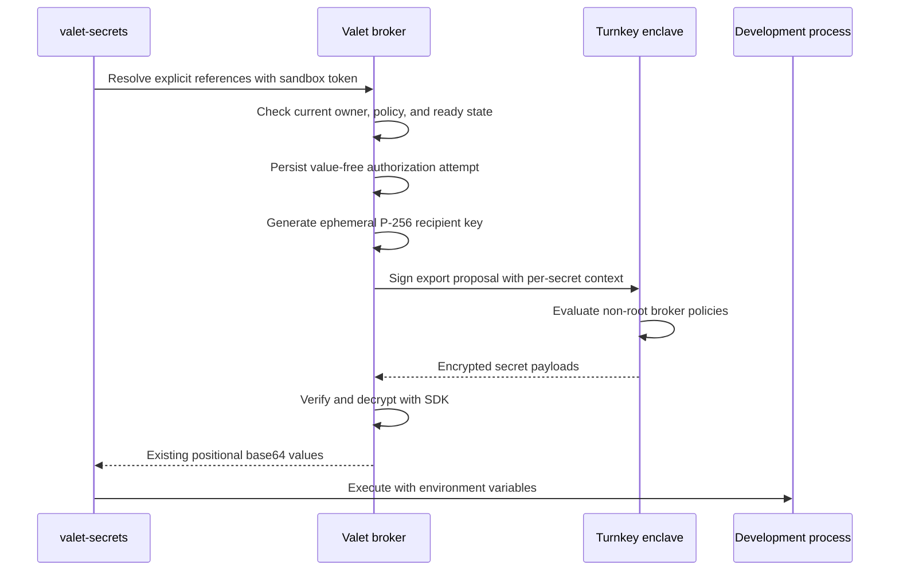

# Turnkey Secrets integration for Valet

**Date:** 2026-10-29
**Status:** Draft for review
**Owners:** Conner Swann and Xiangan He
**Reviewers:** Carey Janecka and Zeke Mostov

## 1. Mental model and goals

Each person gets a locked cabinet in Turnkey. Valet keeps a separate key for that cabinet outside the person's sandbox.
The person puts a development credential into the cabinet from their browser.
A sandbox command asks Valet to deliver that credential into one process's environment.
Valet checks the session's owner and permissions before it asks Turnkey to export the credential.
Turnkey checks the broker user's policies before it releases encrypted data.

The receiving development process has the plaintext secret.
That process can print, copy, or transmit it.
This design keeps secrets out of normal model replies and credential storage.
It does not prevent agent-authored code from stealing a materialized secret.

The first use case is per-user development credentials for the mono local stack and tests.
Carey's Granola workflow setup is a second example of the per-user need.
Conner owns delivery and keeps the integration unblocked.
This draft uses the existing Turnkey handoff documentation.
It does not depend on the older design.

### Goals

- Give each Valet user a Turnkey sub-organization and a distinct broker credential.
- Keep broker credentials outside sandboxes, tool results, and transcripts.
- Reuse `valet-secrets run`, `valet-secrets find`, and repository command declarations.
- Let users manage personal secrets under organization policy bounds.
- Preserve organization-admin and team-admin control of shared secrets.
- Separate permission to import from permission to export.
- Preserve 1Password service accounts as the interim provider.
- Ship a small personal-development pilot in about two weeks.

### Explicit v1 non-goals

| Excluded from the first release | Reason | Later integration point |
| --- | --- | --- |
| Team and organization secret delivery | Personal credentials unblock the first use case | The owner mappings in section 3 |
| Fully unattended sub-org activation after one pasted parent key | The parent cannot configure child users or policies | Human setup now; Turnkey bootstrap support later |
| Pending interactive approvals during shell resolution | The current CLI has a 30-second request timeout | A durable approval flow with a new CLI contract |
| Plaintext read buttons or secret-returning agent actions | They would put plaintext into browser responses or tool results | A separately reviewed product requirement |
| `tk` CLI installation, short-lived Turnkey grants, and commit signing | They are follow-on work | The same per-owner Turnkey identity |
| Moving OAuth refresh tokens or integration app keys into Turnkey | Those consumers have separate renewal and signing rules | Explicit credential references after a separate review |
| Automatic 1Password copying or fuzzy provider fallback | Migration requires an explicit source choice | Per-reference migration |
| Production credentials and strong non-disclosure from sandbox users | Arbitrary development code receives plaintext | A separate restricted execution service |

### Acceptance scenario

Start with two Valet users, Alice and Bob, and a configured parent connection.
Use only synthetic development credentials.

1. Alice opens Personal workspace Secrets.
2. Valet creates Alice's sub-org and shows `Setup required`.
3. A human Turnkey administrator activates Alice's broker user and policies.
4. Alice imports `granola/api-key` through browser-side encryption.
5. Alice runs a development test with `tksecret://personal/granola/api-key`.
6. The child process receives the exact test value.
7. Bob cannot list or resolve Alice's secret.
8. Alice's team-owned execution cannot resolve Alice's personal reference.
9. An organization deny blocks Alice's next resolution.
10. An existing `op://` command still succeeds.

All steps must pass in one run from a clean database.
Sections 5, 6, and 13 define the failure cases.
The implementation adds tests for these cases.
This docs-only change adds no test infrastructure.

## 2. Verified foundations

These are observations from the documentation and SDK fetched on 2026-10-29.
They are separate from the proposed Valet behavior below.

| Fact | Evidence and consequence |
| --- | --- |
| Names are unique within a Turnkey organization | [Managed Secrets](https://docs.turnkey.com/features/secrets.md) and SDK `ImportSecretParams` document uniqueness |
| Static properties are permanent | The public API's `ImportSecretParams` permanently binds them at import |
| The API provides import, export, list, and delete | No update-secret operation appears in the fetched public API; treat values as immutable |
| Same-name replacement requires delete, then import | Valet must expose the interruption and possible replacement failure |
| Root quorum bypasses policy | [Root quorum](https://docs.turnkey.com/features/users/root-quorum.md) and [policy evaluation](https://docs.turnkey.com/features/policies/overview.md) evaluate root first |
| A parent has read-only child visibility | [Sub-organizations](https://docs.turnkey.com/features/sub-organizations.md); parent listing does not authorize child import, export, or delete |
| Export targets an ephemeral P-256 recipient key | Managed Secrets uses the established enclave secure channel and HPKE |
| Batch export is all-or-nothing | One denied secret rejects the entire Turnkey export activity |
| Context is per secret, signed, and audited | Managed Secrets describes `request_context` as asserted claims, not verified facts |
| Policies can read context | The [Secrets language section](https://docs.turnkey.com/features/policies/language.md#secrets) supports `request_context['key']` |
| Missing context keys cause evaluation errors | An erroring allow policy does not allow; an erroring deny policy does not deny |
| Duplicate context keys are rejected | Turnkey rejects duplicates within one secret before policy evaluation |
| Listing has no name or prefix filter | [List secrets](https://docs.turnkey.com/api-reference/queries/list-secrets.md) accepts organization ID and pagination only |
| The first 100 secrets are free | Managed Secrets asks customers to contact sales beyond that count; billing rolls up to the parent |

An individual root member below quorum can still require policies.
A satisfied root quorum bypasses all policies.
The online broker must be a non-root user in every Turnkey organization.
A sole-root broker would bypass all proposed Turnkey restrictions.

### SDK evidence

The inspected `tkhq/sdk` revision is `9181fbc80f7011a4264eb7a1e02db9eb92a85c97`.
Pin a published version with these methods before implementation.
Do not assume the repository's latest source is already on npm.

- [`packages/sdk-server/src/secrets.ts`](https://github.com/tkhq/sdk/blob/9181fbc80f7011a4264eb7a1e02db9eb92a85c97/packages/sdk-server/src/secrets.ts) defines `ExportSecretItem.requestContext` and `CreateExportSecretsProposalParams.secrets`.
- [`packages/sdk-server/src/sdk-client.ts`](https://github.com/tkhq/sdk/blob/9181fbc80f7011a4264eb7a1e02db9eb92a85c97/packages/sdk-server/src/sdk-client.ts) implements `importSecret`, `exportSecret`, `getSecrets`, `createExportSecretsProposal`, `submitExportSecrets`, and `awaitExportedSecrets`.
- `createExportSecretsProposal` supports batches with per-secret `requestContext` today.
- It sorts context keys and converts the record to the existing API key-value array.
- `getSecrets` forwards pagination to `listSecrets`.
- It does not fetch every page automatically.
- `importSecret` calls `init_import_secrets` through `command` because that RPC lacks a generated client method.
- [`packages/crypto/src/turnkey.ts`](https://github.com/tkhq/sdk/blob/9181fbc80f7011a4264eb7a1e02db9eb92a85c97/packages/crypto/src/turnkey.ts) provides `encryptSecretToBundle` and `decryptSecretBundle`.

Use Turnkey's [enclave secure-channel protocol](https://docs.turnkey.com/security/enclave-secure-channels.md).
Do not define a new ciphertext format or signing protocol.
The [programmable credential access guide](https://docs.turnkey.com/solutions/key-management/programmable-credential-access.md) documents proposal signing and consensus.
V1 uses unilateral broker export after Valet authorization.
V1 does not equate a Valet approval with a Turnkey co-signature.

## 3. Organization topology and bootstrap

### Placement

| Valet scope | Turnkey placement | Root administrators | Online credential |
| --- | --- | --- | --- |
| Company | Existing company parent organization | Named human company administrators | Non-root provisioner key restricted to sub-org creation |
| User | One direct child sub-org per immutable Valet user ID | Human company administrators registered inside that child | Distinct non-root user and API key inside that child |
| Team, later | One direct child sub-org per immutable Valet team ID | Human company administrators registered inside that child | Distinct non-root team broker user and API key |
| Organization secrets, later | One dedicated shared-secrets child sub-org | Human company administrators | Distinct non-root organization-secrets broker credential |

Use sibling team sub-orgs under the company parent.
This keeps the parent provisioner separate from shared-secret operations.
It also prevents a broad team export policy from covering another team's secrets.
Company-org storage would share a larger policy and metadata domain.
A dedicated shared-secrets child gives organization secrets the same operating model.

Team administrators manage team secrets through Valet.
They do not become Turnkey root users automatically.
The user sub-org is company-managed storage for that user's Valet credentials.
It does not promise secrecy from the company's human root administrators.
Root administrators can change policies and export secrets through root quorum.

The parent API key and the child API key have different jobs.
The parent key creates child organizations and can inspect child metadata.
It cannot perform child secret operations.
Each child broker must authenticate as a user inside that child.
A public key reused across children would weaken compromise isolation.
Generate a distinct API key pair for each child instead.

### Admin connection

An organization admin opens Organization Apps and plugins, then Turnkey Secrets.
The connection needs the parent organization ID, API public key, and API private key.
An API private key alone does not identify the organization or its user.
The UI clears the private-key input after submission.
Valet validates the connection without importing or exporting a secret.

The preferred pasted credential belongs to a non-root provisioner user.
Human root administrators install a policy allowing only `ACTIVITY_TYPE_CREATE_SUB_ORGANIZATION_V9` for that user.
The implementation must confirm the deployed activity version before installing that policy.
The provisioner receives no secret-operation or policy-management allow.
Turnkey's implicit read permissions still permit metadata queries.

If an admin initially pastes a sole-root credential, the connection remains `Setup required`.
A human installs the scoped provisioner credential through the setup procedure.
Valet discards the pasted root credential after replacement or cancellation.
Valet never marks a retained root credential ready for online operation.
Setup instructions must explain the root-quorum bypass before requesting a credential.

### Lazy provisioning with an explicit activation step

1. The first authorized visit to a scope creates a durable provisioning intent.
2. Valet generates that scope's broker key pair outside the sandbox.
3. The parent provisioner creates the child with the approved human root public credentials.
4. Valet records the returned child organization ID.
5. A human root quorum signs child-local creation of the non-root broker user.
6. The human quorum installs the import, export, and delete policies.
7. Valet verifies the broker's identity, root exclusion, and installed policy template.
8. Valet marks the scope `ready`.

No secret operation is allowed before step 8.
The operator setup command can submit root-approved activities from an administrator's workstation.
Its root signing material must never pass through Valet or an agent sandbox.
Public administrator authenticators can be registered in multiple child orgs.
Turnkey user IDs remain child-local.

The current create-sub-org API accepts root users and a root threshold.
It does not accept initial non-root users or policies.
Therefore, one pasted parent key cannot complete this design without additional child-local authorization.
The personal pilot accepts human activation for a small user cohort.
Fully automatic activation requires a separately approved bootstrap mechanism.
Do not retain a child root key merely to hide this product limitation.

A later team-create hook records the desired team scope.
It does not make team creation depend on Turnkey availability.
The first team-secret setup triggers child creation and activation.

Provisioning serializes on `(org_id, owner_type, owner_id)`.
Persist the exact signed activity request before submission.
After a timeout, query the recorded activity before retrying its bytes.
An ambiguous create result moves the intent to `needs_operator`.
An operator resolves the recorded activity by its saved identifier.
A crash must not create an untracked second child.

## 4. Plugin, settings, and secret model

### Existing integration seams

`CredentialDeclaration` in `packages/engine/src/valet-plugin.ts` describes manual key entry.
`credentialsRouter` in `packages/api/src/routes/credentials.ts` handles user, team, and organization credential owners.
`PgCredentialStore` in `packages/api/src/plugins/credential-store.ts` encrypts secret columns with the instance key.
Its metadata column is ordinary JSON.
Private keys must never be stored in metadata.

Add a Turnkey plugin manifest following the dated v2 plugin convention in `CLAUDE.md`.
The plugin declares secret-management actions for the permission catalog.
The admin connection uses a dedicated settings form because Turnkey needs three connection fields.
The form follows the existing settings grouping in `docs/specs/2026-10-08-settings-redesign-design.md`.
Personal workspace Secrets shows provisioning status and personal secret metadata.
The later team page pins its team ID from the settings route.

Reserve internal credential services `turnkey:provisioner` and `turnkey:broker:<scope-id>`.
Store each private key in `apiKeyEnc` through the existing encryption helpers.
Store public key, Turnkey organization ID, and broker user ID as metadata.
Add these services to `isDeniedCredentialService` in `packages/api/src/services/credential-resolution.ts`.
Refuse generic credential PUT, delegation, and reference writes for these reserved services.
The plugin must not declare its broker key as an ordinary org-provided action credential.
The service adapter selects internal credentials only after authorization.

### References and names

Use a provider-specific locator alongside the existing `op://` locator.
The locator selects a secret through Valet.
Turnkey requests use the existing SDK wire format.

```text
tksecret://personal/granola/api-key
tksecret://team/mono/local-stack/database-password
tksecret://org/mono/package-registry-token
```

The authority is exactly `personal`, `team`, or `org`.
The remaining path is the exact Turnkey secret name.
For v1, names contain lowercase ASCII letters, digits, `/`, `.`, `_`, and `-`.
Each path segment must be nonempty.
Reject `.` and `..` segments, percent escapes, control characters, queries, fragments, userinfo, and ports.
Names contain no secret material or personal contact information.
The personal authority selects the execution owner's sub-org.
The team authority selects the execution's persisted team owner.
Callers cannot choose a different user or team in the locator.

```sh
valet-secrets run --env GRANOLA_API_KEY=tksecret://personal/granola/api-key -- granola-test
```

```yaml
commands:
  - command: granola-test
    env: GRANOLA_API_KEY
    reference: tksecret://personal/granola/api-key
```

`loadCredentialCommands` in `packages/api/src/engine/credential-commands.ts` currently accepts only an `op://` prefix.
Extend it with the same strict provider parser used by the broker.
`secretsCliScript` and `commandWrapperScript` in `packages/api/src/engine/secrets-cli-script.ts` retain environment delivery.
An explicit Turnkey reference never falls back to 1Password.
A supplied `--scope` must agree with the Turnkey authority.
The public CLI label `personal` maps to the database owner type `user`.

Extend discovery with `valet-secrets find --provider turnkey <name>`.
Keep unqualified `find` on its current 1Password behavior during the pilot.
A Turnkey query searches metadata only within the authorized scope.
It returns scope-tagged references without values.
Multiple matches require explicit selection.
Repository declarations do not grant access.

### Static properties

Valet constructs these string properties on every import:

```json
{
  "valet_schema": "1",
  "valet_org_id": "org-example",
  "valet_scope": "user",
  "valet_owner_id": "alice-example",
  "purpose": "development",
  "materialization": "sandbox-env"
}
```

The server derives organization, scope, and owner from authenticated state.
The client cannot override reserved properties.
V1 fixes purpose to `development`.
A later team import uses `valet_scope: team` and that team's immutable ID.
These properties classify secrets for export policy.
They do not prove the identity of the receiving process.
Changing a property requires secret replacement.

Use one secret per credential value.
Do not pack unrelated credentials into one JSON secret to reduce billing.
Packing would make export disclose unrelated values.
For 80 users with eight credentials each, personal storage alone needs 640 secrets.
Confirm the free allowance's billing boundary with Carey before expanding the pilot.
Do not assume each sub-org gets a separate free allowance.

## 5. Authorization in two layers

### Layer one: Valet identity and permission

The existing broker requires `c.var.sandbox` in `packages/api/src/routes/sandbox-secrets.ts`.
`sessionOwnerRow` reads the persisted session owner or `workflowSessionOwner`.
`onePasswordScopesFor` in `packages/api/src/services/credential-resolution.ts` defines current provider scope access.
The existing routes do not invoke the action-policy resolver.
Turnkey authorization is new work at this route.
Do not describe today's 1Password broker as policy-gated.

Before any Turnkey metadata query or export, the broker must:

1. Authenticate the sandbox through `verifySandboxToken` in `packages/api/src/auth/sandbox-tokens.ts`.
2. Load the current execution owner from durable state.
3. Check current organization membership and account state.
4. For a team execution, validate its team and current authority.
5. Select the exact allowed secret scope.
6. Check the scope's ready state and secret policy.
7. Write a value-free authorization attempt before contacting Turnkey.

Personal export requires a user-owned execution whose owner matches the sandbox principal's user ID.
A team-owned execution never borrows its frozen actor's personal sub-org.
An unknown owner gets no Turnkey scope.
This is stricter than the existing broker's organization fallback.
A moved execution loses its old personal scope immediately.
A deleted or disabled scope cannot export through an old token.

`ensureAssistantExecution` in `packages/api/src/assistants/service.ts` allocates team conversation executions.
`canAccessSessionResources` in `packages/api/src/services/session-access.ts` checks execution resource access.
`threadReadAccess` in `packages/api/src/services/thread-access.ts` checks the thread audience.
The implementation must use persisted execution ownership.

A sandbox token identifies a session.
It contains no thread or active-submission identity.
The broker cannot verify a caller-supplied thread ID as a stronger security principal.
V1 permissions therefore apply to the entire execution's secret scope.
V1 ignores thread approval bypass and action runtime grants for secret resolution.
The audit records the execution ID.
It leaves the thread ID empty unless the host supplies verified provenance.
Any process with the same token can request the same allowed development secrets.

`docs/specs/2026-10-13-thread-sharing-design.md` keeps guest turns out of the owner's sandbox tools.
A shared-thread reply grants no direct secret endpoint access.
Owner-run code still shares the execution's sandbox boundary.
Per-thread secret restrictions need a later host-authenticated invocation capability.
Tool focus alone cannot enforce them against an allowed shell.

### Permission operations

Register these proposed policy IDs under service `turnkey_secrets`:

| Action ID | Default | Additional authority |
| --- | --- | --- |
| `turnkey_secrets.list` | Allow | Current scope access; metadata only |
| `turnkey_secrets.import` | Require approval | Personal owner, team admin, or org admin for the target scope |
| `turnkey_secrets.materialize` | Require approval | Authorized execution; plaintext delivery is the consequence |
| `turnkey_secrets.delete` | Require approval | Same management authority as import |

A secret policy receives server-derived `scope`, `ownerId`, `name`, and `purpose` parameters.
Ciphertext and plaintext are never policy parameters.
The permission catalog reuses `actionPolicies`, `actionPolicyOverrides`, and their existing settings routes.
Those tables are in `packages/api/src/schema/index.ts`.
`loadPolicyRows` in `packages/api/src/policies/service.ts` loads current settings.
`resolvePolicyDecision` in `packages/api/src/policies/resolution.ts` implements precedence and parameter matching.

Add a broker-specific adapter around those functions.
It supplies empty runtime-grant and workflow-grant lists.
It uses the operation's actual scope owner to select policies.
It does not use session-owner personal overrides to loosen a later org-secret policy.
Preserve the resolver's specificity rules.
A service deny is not a universal kill switch if a more-specific allow wins.
The connection's disabled state provides an unconditional provider stop.

V1 proceeds only when the fresh decision is `allow`.
On `deny`, return 403 before a Turnkey call.
On `require_approval`, return 403 with instructions to configure an allowed development-secret policy in Settings.
Do not open a pending decision gate from a shell request.
Unattended workflows fail the step and report the missing permission.
The pilot admin explicitly allows approved personal-development materialization.
Management UI actions require an explicit confirmation in addition to standing policy.
The confirmation is not a substitute for an `allow` decision.

Set-without-read means an actor can receive `import: allow` and `materialize: deny`.
The import route never exports the saved value as validation.
Delete permission is separate from import permission.
An import-only actor cannot overwrite an existing name.
A later replacement requires delete authorization too.
The actor already knows any plaintext they submit.
This mode prevents retrieval of previously stored values through Valet.
It does not protect a secret from a compromised export broker key.

### Layer two: Turnkey policy on the non-root broker

Install one template per child with literal child-local broker and owner IDs.
The following export policy is concrete JSON with illustrative IDs.
Replace the IDs during activation.

```json
{
  "policyName": "Valet personal development export v1",
  "notes": "Installed by human root administrators; broker is non-root.",
  "effect": "EFFECT_ALLOW",
  "consensus": "approvers.any(u, u.id == 'broker-user-example')",
  "condition": "activity.type == 'ACTIVITY_TYPE_EXPORT_SECRETS' && secret.static_properties['valet_schema'] == '1' && secret.static_properties['valet_org_id'] == 'org-example' && secret.static_properties['valet_scope'] == 'user' && secret.static_properties['valet_owner_id'] == 'alice-example' && secret.static_properties['purpose'] == 'development' && secret.static_properties['materialization'] == 'sandbox-env' && request_context['valet_org_id'] == secret.static_properties['valet_org_id'] && request_context['valet_owner_id'] == secret.static_properties['valet_owner_id'] && request_context['operation'] == 'materialize' && request_context['recipient'] == 'sandbox-env'"
}
```

The same child broker can submit encrypted imports after Valet authorizes the actor:

```json
{
  "policyName": "Valet encrypted import v1",
  "notes": "Valet authorizes actor and supplies reserved import properties.",
  "effect": "EFFECT_ALLOW",
  "consensus": "approvers.any(u, u.id == 'broker-user-example')",
  "condition": "activity.type == 'ACTIVITY_TYPE_INIT_IMPORT_SECRETS' || activity.type == 'ACTIVITY_TYPE_IMPORT_SECRETS'"
}
```

Deletion uses a separate allow:

```json
{
  "policyName": "Valet deletion v1",
  "notes": "Valet checks owner and delete permission before submission.",
  "effect": "EFFECT_ALLOW",
  "consensus": "approvers.any(u, u.id == 'broker-user-example')",
  "condition": "activity.type == 'ACTIVITY_TYPE_DELETE_SECRETS'"
}
```

Do not use export-only `secret` fields to claim import or delete restrictions.
The fetched language reference establishes those fields for export evaluation.
These import and delete allows cover the whole child org.
The separate child boundary limits their reach to one owner.
No policy allows the broker to change policies or root quorum.
Human administrators review other inherited or preexisting allows before activation.
An unrelated broad export allow would bypass this template's conditions.

Turnkey users have implicit metadata read access inside their organization.
A missing list allow does not hide secret names from a stolen key.
Turnkey also has implicit self-credential permissions.
Review an explicit restriction on broker self-credential changes before release.
Do not claim the activity allow list alone prevents all key-management activity.

For every secret, Valet constructs the following context from trusted server state:

```json
{
  "valet_org_id": "org-example",
  "valet_owner_id": "alice-example",
  "operation": "materialize",
  "recipient": "sandbox-env",
  "execution_id": "execution-example",
  "request_id": "request-example"
}
```

The policy checks owner and purpose claims through positive allow conditions.
Missing required keys cannot satisfy that allow.
Execution and request IDs support audit correlation.
Turnkey does not verify that either ID exists in Valet.
No client-supplied context passes through to the signed activity.

A stolen child broker key can assert these same context values.
It can export all matching development secrets to an attacker-chosen P-256 key.
It can import secrets and delete any secret in that child under the shown policies.
It can list that child's metadata.
It cannot use parent status to export a sibling child's secrets.
It cannot satisfy human root quorum or rewrite policies under these allows.
It may retain access through self-key changes unless those operations are explicitly restricted.
A stolen parent provisioner key can create unwanted child organizations and cause cost.
Its parent status alone cannot export existing child secrets.
A compromised Valet API process can obtain every online child broker key.
Per-user keys do not protect against that full server compromise.

## 6. Flows

### Browser import

1. The browser authenticates the person through the existing Valet session.
2. Valet checks management authority and the import policy.
3. Valet creates a short-lived import intent for one name and owner.
4. The child broker signs Turnkey's `init_import_secrets` request.
5. Valet returns the enclave ingress bundle and trusted organization ID.
6. The browser verifies the enclave signature through `encryptSecretToBundle`.
7. The browser encrypts the plaintext with Turnkey's SDK crypto.
8. The browser submits only `secretPayload`, `targetPublicKey`, and the intent ID to Valet.
9. Valet rechecks authority and policy before submitting `importSecrets`.
10. Valet attaches the reserved name and static properties from the intent.
11. Valet records the completed secret ID and returns metadata only.

The browser clears the input after completion or cancellation.
Valet never calls the server `importSecret({ plaintext })` helper for this flow.
Disable request-body tracing on these endpoints.
Reject unexpected plaintext fields.
Keep payloads out of analytics, error reports, and audit JSON.
V1 accepts nonempty UTF-8 development credentials without NUL bytes.
Enforce the published Turnkey size limit once Carey confirms it.
Environment variables cannot represent NUL bytes.

The intent expires after five minutes.
A completed intent returns the recorded secret ID on an identical retry.
A different payload for the same intent returns 409.
Persist the activity request before submission.
On an ambiguous provider response, recover the recorded activity before any new import.
Do not reuse an ingress key for a new import attempt.
A new attempt obtains a fresh ingress bundle.

Browser-side encryption protects against honest-server plaintext handling.
The Valet server still supplies the JavaScript application.
A compromised server or browser extension can steal the input before encryption.
This is not protection from a malicious application origin.

### Operator import

An administrator can use the official Turnkey SDK from their workstation.
The SDK `importSecret` helper encrypts locally before it submits the import.
The workstation uses a child-local import-authorized credential.
The parent credential alone is insufficient.
Read plaintext from a protected input source.
Do not put plaintext in command-line arguments.
Do not use an agent sandbox for this operation.
The operator supplies the same reserved static properties.
An explicit metadata refresh discovers the completed secret.
Normal export policy rejects a secret with missing or different reserved properties.

### Materialization through the existing broker



The API is the export recipient in v1.
It briefly holds plaintext in process memory.
This retains the current shell CLI and broker response contract.
Base64 encodes the value.
It provides no encryption.
TLS protects the API-to-sandbox transfer.
Do not claim end-to-end encryption from Turnkey to the sandbox in this phase.
A later native recipient helper could keep decryption inside the sandbox.

Use `createExportSecretsProposal`, `submitExportSecrets`, and `awaitExportedSecrets` for a same-child batch.
Use a fresh recipient key pair for each export activity.
Keep the private key only in request memory.
Do not persist it for retry or approval recovery.
Discard decrypted values and recipient keys after response completion.
JavaScript garbage collection does not guarantee immediate memory erasure.
No plaintext cache is permitted for the Turnkey adapter.

`MAX_REFERENCES` in `packages/api/src/routes/sandbox-secrets.ts` currently limits a request to 25 references.
Keep that limit.
Check every Turnkey reference before submitting any export in the request.
Group authorized references by child organization.
Turnkey provides atomicity within each export activity.
Valet cannot provide atomicity across organizations or providers.
If any group fails, return no Turnkey values and do not start the child process.
Earlier groups may already have exported into broker memory.
Record that partial provider execution in the audit.
Do not return partial values from a failed Turnkey resolution.

Keep `ResolveSandboxSecretsResponse` in `packages/api/src/wire/types.ts` for successful responses.
`secretsCliScript` already decodes positional base64 values before execution.
It unsets `VALET_SANDBOX_TOKEN` from the child environment.
The credential mount may still contain that token.
The child also has access to its injected value and same-sandbox processes.
This remains one sandbox trust boundary.

A provider timeout ends resolution without starting the command.
If Turnkey returns `CONSENSUS_NEEDED`, fail with a setup-policy error.
V1 does not preserve a recipient private key across a human approval wait.
The CLI's total request deadline remains 30 seconds.
The adapter must use a shorter provider deadline within that budget.
An API restart fails the in-flight request.
A new request creates a new recipient key and audit attempt.

### List and find

Valet lists metadata through the selected child broker credential.
The parent credential is not needed for normal discovery.
Fetch every page needed for the query through `listSecrets` or `getSecrets`.
Filter names locally because Turnkey has no name-filter parameter.
Use exact name equality for resolution.
A bounded search reports truncation when it cannot inspect all metadata.
It must not report an exhaustive miss in that case.

Keep a metadata-only index keyed by child organization and secret ID.
Invalidate it after writes.
Before export, verify current metadata and exact owner properties against Turnkey.
A stale index never supplies a value or authorizes an export.
Treat names and static properties as sensitive metadata.
Do not expose another owner's inventory through global search.

### Delete and rotate

Deletion requires current management authority, delete policy allow, and explicit confirmation.
Valet marks the name unavailable before submitting the delete activity.
Concurrent resolution of that name fails closed.
After provider completion, Valet removes the active metadata entry.
A provider failure leaves the operation visible for retry or operator recovery.
Do not report deletion complete from a local tombstone alone.

Rotation is a serialized delete followed by encrypted import under the same name.
The replacement gets a new Turnkey secret ID.
References continue to use the name.
Valet must obtain both delete and import authorization before deleting anything.
The browser prepares the encrypted replacement before deletion.
If its ingress bundle becomes unusable, obtain a fresh bundle before proceeding.

There is an interval when the name cannot resolve.
If import fails after delete, the old value is gone.
Valet shows `Replacement failed. Import the replacement again.`
It must not silently restore the old value from a plaintext cache.
For a lower-risk rollout, import a versioned name and update consumers before deleting the old name.
V1 has no atomic alias switch or transactional Turnkey replacement.

### Offboarding

Organization removal disables the user's scope before further broker work.
Recheck live membership on each Turnkey request because sandbox tokens are durable.
`getOrCreateSandboxToken` in `packages/api/src/auth/sandbox-tokens.ts` creates lifetime credentials.
Do not rely on the older broker spec's token-expiry description.
Use `revokeSandboxTokens` during execution teardown.
Revocation cannot recover values already delivered to a development process.

Keep a durable offboarding record before deleting local owner rows.
Human root administrators revoke the child broker user or its keys.
Valet removes its encrypted broker key after confirmed revocation.
If remote revocation fails, keep the scope disabled and alert an operator.
Retain the key encrypted for the authorized retry until revocation succeeds.
Deleting the local key alone does not revoke an attacker's copy.

A user can delete their own secrets under delete policy while they remain a member.
Organization offboarding uses an explicit retention decision from an organization admin.
Do not automatically destroy personal or team secrets when a Valet owner row disappears.
Only the child root can initiate child deletion under the documented sub-org rules.
The parent cannot perform that deletion alone.
Confirm secret-retention and child-deletion behavior with Turnkey before offering whole-child removal.

Later team deletion disables the team scope under `lockTeamForOwnership`.
`deleteTeam` and `removeMember` in `packages/api/src/services/teams.ts` are the existing lifecycle hooks.
Removing one member revokes their future Valet access to team secrets.
It does not delete the team's shared secret or reclaim previously delivered plaintext.
A team membership change cannot authorize a personal reference.

## 7. Proposed data model and routes

All changes in this section are proposed work.
The named existing files are the implementation locations.
No new tables or routes are implemented by this PR.

### Tables

Add app tables in `packages/api/src/schema/index.ts` and `packages/api/migrations/pg/0000_app.sql`.
Add the matching `SCHEMA_REPAIRS` entries in `packages/api/src/lib/drizzle.ts`.
This follows the current pre-1.0 migration convention.

| Proposed table | Columns and constraints |
| --- | --- |
| `turnkey_connections` | `org_id` primary key; `parent_organization_id`; provisioner credential service; approved human root public configuration; `state`; `generation`; timestamps |
| `turnkey_secret_scopes` | `id` primary key; `org_id`; `owner_type` (`user`, `team`, `org`); `owner_id`; child organization ID; broker user ID; broker credential service; policy template version; `state`; `generation`; timestamps; unique `(org_id, owner_type, owner_id)`; unique child organization ID |
| `turnkey_secret_operations` | `id` primary key; scope ID; operation kind; name; idempotency key; exact signed-request bytes or protected ciphertext request; activity ID; state; sanitized error code; expiry; timestamps; unique `(scope_id, idempotency_key)` |
| `turnkey_secret_index` | scope ID and secret ID composite primary key; name; reserved static properties; provider creation time; refresh time; unique active `(scope_id, name)` |
| `turnkey_secret_audit` | request ID primary key; Valet org and scope IDs; actor or sandbox principal; execution ID; verified thread ID if available; action; referenced secret IDs; policy decision and provenance IDs; provider activity IDs; outcome; timestamps |

Private keys remain in encrypted `credentials` secret columns.
Operational request bodies need access controls and bounded retention.
They contain ciphertext and public keys, never imported plaintext or ephemeral export private keys.
Provisioning, import, rotation, and offboarding share the durable operation table.
Scope states are `pending`, `needs_operator`, `ready`, `disabled`, and `offboarding`.
Each state transition records the connection generation.
A stale completion cannot reactivate a disabled scope.

The audit table accepts a minimal attempt row before provider submission.
If that write fails, deny the operation with an actionable retry error.
`persistInvocationAudit` in `packages/api/src/policies/service.ts` intentionally swallows audit failures.
That behavior is unsuitable for this pre-export requirement.
Use a dedicated awaited audit writer.
Record only fixed error codes and safe metadata.
Never pass the materialization response to a generic action audit result.
Monitor incomplete attempts because provider execution and database completion cannot commit atomically.

### API routes

Mount proposed authenticated settings routes through `packages/api/src/app.ts`.
Add request and response types in `packages/api/src/wire/types.ts`.
Keep provider parsing and SDK calls in one API-owned adapter beside `packages/api/src/services/onepassword.ts`.

| Proposed route | Caller and result |
| --- | --- |
| `PUT /api/turnkey-secrets/connection` | Browser org admin; saves scoped connection; returns status only |
| `GET /api/turnkey-secrets/connection` | Browser org admin; public metadata and activation status |
| `DELETE /api/turnkey-secrets/connection` | Browser org admin; disables provider; does not delete remote secrets |
| `POST /api/turnkey-secrets/scopes/ensure` | Browser personal owner or authorized scope admin; creates or returns provisioning intent |
| `POST /api/turnkey-secrets/scopes/:id/verify-activation` | Browser scope admin; verifies externally installed identity and policies |
| `GET /api/turnkey-secrets/secrets?scope=personal` | Browser personal owner; authorized metadata only; later accepts team or org scope |
| `POST /api/turnkey-secrets/imports` | Browser authorized writer; accepts name and scope; returns ingress bundle and intent ID |
| `POST /api/turnkey-secrets/imports/:id/complete` | Same authenticated writer; ciphertext only; returns secret metadata |
| `DELETE /api/turnkey-secrets/secrets/:id` | Authorized scope manager; confirmation and delete allow required |
| `POST /api/turnkey-secrets/secrets/:id/rotate` | Authorized scope manager; records delete/import operation; ciphertext replacement only |

Scope IDs and secret IDs never substitute for ownership checks.
Every lookup includes the caller's Valet organization.
Personal routes cannot select another user ID.
Later team writes use the existing team-deletion and role locks.
The route refuses a cross-organization team before contacting Turnkey.

Existing routes remain the sandbox interface:

- Extend `POST /api/sandbox-secrets/resolve` with explicit `tksecret://` dispatch.
- Extend `POST /api/sandbox-secrets/find` with an explicit Turnkey provider selector.
- Keep these routes sandbox-principal-only.
- Keep cookies and ordinary user API keys unable to resolve plaintext there.
- Keep `op://` requests on their existing behavior.

`packages/api/src/middleware/auth.ts` already restricts sandbox tokens to approved route prefixes.
The new settings routes do not belong in that allowlist.
The middleware also restricts agent API keys to approved operations.
V1 keeps management on the browser path.
The operator uses the official Turnkey SDK.
Agent API keys retain their current management restrictions.
A later Valet operator CLI needs a separate authorization review.

## 8. Migration and coexistence

Keep 1Password service accounts connected throughout the pilot.
`createOnePasswordService` in `packages/api/src/services/onepassword.ts` remains the `op://` adapter.
Keep its scope ordering and configured-team failure behavior unchanged.
Turnkey and 1Password must not share a plaintext cache.

1. Enable Turnkey for a small personal-development cohort.
2. Activate each user's sub-org with human administration.
3. Import each chosen credential explicitly through the browser or operator path.
4. Test the new reference with a command that checks success without printing the value.
5. Change the repository declaration or workflow reference explicitly.
6. Remove the old credential only after the owner confirms migration.

A missing Turnkey secret names the reference and suggests checking Personal workspace Secrets.
It does not try a same-named 1Password item.
A Turnkey outage fails Turnkey references without changing `op://` behavior.
Disabling Turnkey blocks new Turnkey resolution and preserves the existing 1Password path.
Rollback does not rewrite references or delete remote data.

A personal workflow's sandbox can use the new reference after the same owner and policy checks.
An integration action running in the Valet server does not gain Turnkey lookup automatically.
The Granola example fits the pilot when a workflow sandbox command consumes the credential.
A native Granola integration needs a later explicit reference path in the shared credential readers.
That path must preserve `readUserCredential`, `readTeamCredential`, and `orgFallbackPolicy` semantics in `packages/api/src/services/credential-resolution.ts`.
It must also preserve native app-key restrictions from `docs/specs/2026-10-15-native-integration-credential-policy-design.md`.

## 9. Delivery phases

### Phase 1: personal-development pilot, about two weeks

Conner owns the broker, permission adapter, and provisioning state.
Xiangan owns the settings, browser encryption, and SDK adapter.
Both review policy templates and negative tests before the pilot.

| Time | Deliverable |
| --- | --- |
| Days 1 and 2 | Pin SDK version; confirm browser crypto; approve human-activation procedure and policy template |
| Days 3 through 5 | Connection, lazy personal scope creation, operator activation, encrypted credential storage, metadata listing |
| Days 6 through 8 | Browser import, personal broker materialization, explicit references, CLI and declaration parsing |
| Days 9 and 10 | Delete/rotation failure states, scope disable/offboarding, audit, cross-user tests, live synthetic pilot |

The pilot includes set-without-read policy tests.
It uses standing policy allows for development-secret export.
It includes no team delivery, native integration lookup, or automatic provider migration.
Human activation is a documented launch prerequisite.
If that prerequisite is unacceptable, bootstrap support becomes the launch blocker.
Do not trade away non-root brokers to meet the two-week date.

### Phase 2: shared scopes and integration consumers

Add lazy team and organization-secrets child activation.
Apply management roles under the existing ownership locks.
Add explicit Turnkey-backed integration credential references.
Never discover an integration's credential by a broad cross-provider name search.
Extend workflow readiness only when the runtime consumer is implemented.

### Phase 3: stronger delegation

Review fully automatic bootstrap with Turnkey.
Review an in-sandbox native decrypting helper.
Review durable approvals bound to recipient keys and exact secret batches.
Short-lived grants, the `tk` CLI, and commit signing remain separate proposals.

## 10. Threat model and invariants

| Threat | Intended protection | Residual risk |
| --- | --- | --- |
| Malicious repository names another person's secret | Reference parser derives scope from the execution owner | An allowed command can steal its own delivered secret |
| Stolen sandbox token | Live owner, membership, disabled-state, and policy checks before export | The token is durable and can access allowed execution secrets until revoked |
| Team thread uses a creator's personal credential | Team executions never select personal sub-orgs | Team materialization is available to authorized team code |
| Stolen child broker key | Child-local non-root identity and narrow export classifications | Attacker can forge context and select their own export recipient |
| Stolen parent provisioner key | No child secret-operation authority from parent status | Child creation, metadata exposure, and billing abuse remain possible |
| Valet database theft | Existing encrypted credential columns; no stored secret plaintext | Database plus instance encryption key exposes broker credentials |
| Valet server compromise | Human root keys remain outside Valet | Online keys and materialized plaintext are exposed |
| Browser compromise or malicious frontend | Verified enclave ingress bundle protects transport destination | Input can be stolen before encryption |
| Provider or network failure | Fail-closed resolution; no child execution with partial Turnkey values | Rotation can leave a deleted name unavailable |
| Logging or exception capture | Allowlisted audit fields and fixed error codes | Receiving processes may print plaintext into captured output |

Required invariants:

- **INV-1:** Only a verified non-root broker can mark a scope ready. Activation tests inspect the child root quorum.
- **INV-2:** Every Turnkey operation selects a durable Valet owner. Cross-user and moved-owner tests must fail before SDK invocation.
- **INV-3:** Import requests contain no plaintext. Browser network tests inspect all Valet-bound requests with a synthetic sentinel value.
- **INV-4:** Secret values never enter action results or audit JSON. Tests search database rows, events, and captured logs for the sentinel.
- **INV-5:** Every export checks fresh policy and disabled state. A policy-revoke test changes the result without restarting Valet.
- **INV-6:** A broker context claim grants no independent trust. A stolen-key test demonstrates export with forged execution context.
- **INV-7:** A failed Turnkey resolution never starts the command. A batch test checks the child-start marker remains absent.
- **INV-8:** V1 permits only reviewed development secrets. Import validation fixes the classification and rejects caller overrides.

Set rate limits per sandbox and scope.
Cap metadata pagination and concurrent provider requests.
Expose metrics for denied exports, provider failures, incomplete operations, provisioning ambiguity, and scopes awaiting revocation.
Keep secret names out of metric labels.
Alert on unexpected root activities and policy-template drift.
Fail closed on drift that invalidates the non-root or export-policy assumptions.
Retain operator-visible recovery instructions.
Do not silently repair permissions.

## 11. Turnkey-side dependencies and gaps

These are separate from Valet implementation work.

| Dependency or question | Current evidence | Required action |
| --- | --- | --- |
| SDK batch export with context | Implemented at the inspected SDK revision | Confirm a published version; no new batch API is required |
| Browser import composition | Crypto helpers exist; server helper combines ingress initialization and encryption | Verify browser packaging and enclave verification with the selected release |
| Generated ingress initialization | SDK uses `command` because generated `init_import_secrets` is absent | Publish the generated method or document the supported raw call |
| Fully automatic non-root bootstrap | Create-sub-org accepts root users without initial non-root users or policies | Turnkey-supported atomic setup or a separately reviewed human authorization mechanism |
| Server-side name/prefix lookup | List API exposes pagination only | Optional provider improvement; Valet can paginate for the pilot |
| Policy evaluation for import/delete | Verified `secret` and context semantics apply to export | Confirm whether narrower import/delete constraints exist; do not assume them |
| Broker self-key mutation | Policy overview documents implicit self-credential permissions | Confirm explicit restriction activities and live negative tests |
| Product limits and billing | First 100 secrets free; parent billing rollup | Confirm payload limits, pagination/rate limits, pricing, and allowance scope |
| Complete child deletion | Child root participation is required | Confirm treatment of stored secrets and retention before a deletion UI |

The basic pilot does not require a new export protocol.
It does require verified child activation and a supported SDK release.
Automatic single-paste activation remains a separate dependency.

## 12. Questions for Carey and Zeke

1. Can Turnkey create a child with human roots, a non-root broker, and initial policies in one supported operation?
2. If not, is manual child activation acceptable for the two-week pilot?
3. Which published SDK release includes the inspected Secrets proposal and crypto helpers?
4. Is `encryptSecretToBundle` supported in Valet's browser build without a server plaintext helper?
5. Should human roots use a specific quorum threshold and recovery setup in every child?
6. Do the shown export conditions and activity types work against the deployed Secrets API?
7. Which policies restrict a broker's implicit self-credential changes without blocking operation?
8. Can policies restrict import properties or delete targets more narrowly than the proposed child-wide allows?
9. What are the current payload-size, rate, pagination, and activity-retention limits?
10. Does the free allowance apply across the company and its children, and what is pricing above 100 secrets?
11. What retention and ownership rules apply to a departing employee's user sub-org?
12. Does child deletion destroy secrets immediately, and what recovery is possible?
13. Is the native Granola action path needed in the first release, or does sandbox workflow delivery unblock the case?
14. Should team and organization secrets use the recommended dedicated child sub-orgs?

## 13. Testable acceptance criteria

Use synthetic values and disposable Turnkey organizations.
The implementation must report live tests separately from fake-SDK tests.
A docs review does not certify provider behavior.

| ID | Setup and action | Expected observation |
| --- | --- | --- |
| A1 | Two simultaneous first visits for Alice | One tracked child provisioning operation; ambiguous remote state requires operator review |
| A2 | Child broker is a sole root | Activation refuses; no secret operation becomes available |
| A3 | Parent key lists Alice's child, then attempts child export | Metadata list works; export fails without a child-local authorized credential |
| A4 | Alice imports a sentinel through the browser | Valet receives no sentinel plaintext; completed response contains metadata only |
| A5 | Browser receives a modified enclave ingress bundle | Signature verification fails before ciphertext submission |
| A6 | Alice materializes a value with quotes, backslashes, Unicode, and a trailing newline | Child receives exact bytes; normal tool output and audit contain no value |
| A7 | Bob submits Alice's secret ID, owner ID, or scope ID | 403 or existence-hiding 404; zero SDK secret operations |
| A8 | Team execution requests its creator's personal reference | 403 before provider lookup |
| A9 | Old token is used after personal ownership moves | Previous user's scope cannot resolve |
| A10 | Import allow and materialize deny apply to Alice | New encrypted import succeeds; retrieval fails; no export occurs during validation |
| A11 | Import-only actor tries an existing name | Conflict; no deletion or overwrite |
| A12 | Org action-specific materialize deny is added after success | Next call fails without API restart; existing action grants cannot override it |
| A13 | Materialize resolves to require approval | CLI receives actionable refusal; no pending gate or export activity |
| A14 | Export omits a required context key | Turnkey does not allow the export under the template |
| A15 | Raw export repeats a context key within one item | Turnkey rejects before policy evaluation |
| A16 | Batch includes one secret with a different owner property | Turnkey exports none of that batch |
| A17 | Stolen child key asserts a fake execution ID with otherwise valid context | Live export can succeed; documentation retains this limitation |
| A18 | That child key tries policy mutation and sibling export | Both fail; separately test all applicable self-key restrictions |
| A19 | Matching secret appears on list page three | Exact resolution finds it; truncated discovery reports truncation |
| A20 | Turnkey export fails after another provider group completed | No child starts; no Turnkey values are returned; audit records provider partial execution |
| A21 | Rotate deletes successfully, then import fails | Name remains unavailable; operation shows replacement failure; retry never silently restores old plaintext |
| A22 | User leaves the organization with a live sandbox token | New Turnkey reads fail immediately; remote revocation task remains visible until confirmed |
| A23 | Audit database write fails | Export does not occur; caller gets a retry instruction |
| A24 | Turnkey provider is disabled or unavailable | Turnkey references fail; unchanged `op://` commands still work |
| A25 | Import or provisioning request loses its response | Recovery uses the recorded activity; it does not create an untracked duplicate |
| A26 | Turnkey SDK returns raw errors containing the sentinel | Client, transcript, logs, and audit contain only sanitized error codes |
| A27 | A cookie, agent API key, or unknown owner calls sandbox resolve | No plaintext response and no Turnkey export |
| A28 | Allowed command deliberately prints its injected value | Test demonstrates plaintext exposure; product copy does not claim prevention |

Extend the existing broker, CLI, and declaration suites at these paths:

- `packages/api/src/routes/sandbox-secrets.test.ts`
- `packages/api/src/engine/secrets-cli-script.test.ts`
- `packages/api/src/engine/credential-commands.test.ts`

Add adapter, browser-import, permission, provisioning, and lifecycle tests with the implementation.
Run the repository's `make e2e` scorecard before release.
Do not add diagram-parser tooling or CI for this design.

## Repository evidence index

The code takes precedence over older specs where they differ.
All entries below refer to the `dev-v2` source inspected for this draft.

| Current implementation | Design use |
| --- | --- |
| `packages/api/src/routes/sandbox-secrets.ts`: `sandboxSecretsRouter`, `sessionOwnerRow`, `narrowScopes`, `MAX_REFERENCES` | Existing sandbox-only broker and owner checks |
| `packages/api/src/engine/secrets-cli-script.ts`: `secretsCliScript`, `commandWrapperScript` | Shell materialization and repository command wrappers |
| `packages/api/src/engine/credential-commands.ts`: `loadCredentialCommands`, `CREDENTIAL_COMMANDS_PATH` | `.valet/credentials.yaml` validation |
| `packages/api/src/services/onepassword.ts`: `createOnePasswordService`, `isOnePasswordReference` | Existing provider isolation and coexistence |
| `packages/api/src/services/credential-resolution.ts`: `onePasswordScopesFor`, `isDeniedCredentialService`, `readUserCredential`, `readTeamCredential`, `orgFallbackPolicy` | Current scope, reserved-service, and integration lookup contracts |
| `packages/api/src/plugins/credential-store.ts`: `PgCredentialStore` | Encrypted private-key persistence |
| `packages/engine/src/valet-plugin.ts`: `CredentialDeclaration` | Plugin credential contract |
| `packages/api/src/auth/sandbox-tokens.ts`: `verifySandboxToken`, `getOrCreateSandboxToken`, `revokeSandboxTokens` | Durable sandbox principals and revocation |
| `packages/api/src/assistants/service.ts`: `ensureAssistantExecution` | Conversation execution allocation |
| `packages/api/src/services/session-access.ts`: `canAccessSessionResources` | Sandbox resource authorization |
| `packages/api/src/services/thread-access.ts`: `threadReadAccess` | Governing thread audience |
| `packages/api/src/workflows/session-owner.ts`: `workflowSessionOwner` | Workflow sandbox ownership |
| `packages/api/src/services/teams.ts`: `lockTeamForOwnership`, `deleteTeam`, `removeMember` | Team lifecycle and mutation serialization |
| `packages/api/src/policies/service.ts`: `loadPolicyRows`, `resolveActionPolicy`, `persistInvocationAudit` | Policy loading and current best-effort audit behavior |
| `packages/api/src/policies/resolution.ts`: `resolvePolicyDecision` | Existing policy precedence |
| `packages/api/src/routes/credentials.ts`: `credentialsRouter` | Existing scope-aware credential administration |
| `packages/api/src/routes/policies.ts`: `policiesRouter` | Organization policy settings |
| `packages/api/src/routes/team-policies.ts`: `teamPoliciesRouter` | Team policy administration |
| `packages/api/src/routes/me-policies.ts`: `mePolicyOverridesRouter` | Personal policy settings |
| `packages/api/src/schema/index.ts`: `credentials`, `orgMembers`, `teamMembers`, `agentSessions`, `sessionThreads`, `assistantExecutions`, `actionPolicies`, `actionPolicyOverrides`, `actionInvocations` | Current app ownership, credential, and policy schema |
| `packages/api/src/lib/drizzle.ts`: `SCHEMA_REPAIRS` | Deployed app-schema repair convention |
| `packages/api/src/middleware/auth.ts`: `SANDBOX_ALLOWED_PATH_PREFIXES` | Sandbox route restrictions |

Related designs: [sandbox broker](2026-09-01-sandbox-secret-broker-design.md), [1Password credentials](2026-07-21-onepassword-credentials-design.md), [team vaults](2026-09-04-team-onepassword-vaults-design.md), [thread execution isolation](2026-10-05-thread-execution-isolation-design.md), [thread sharing](2026-10-13-thread-sharing-design.md), and [task tool scopes](2026-10-15-task-tool-scopes-design.md).
